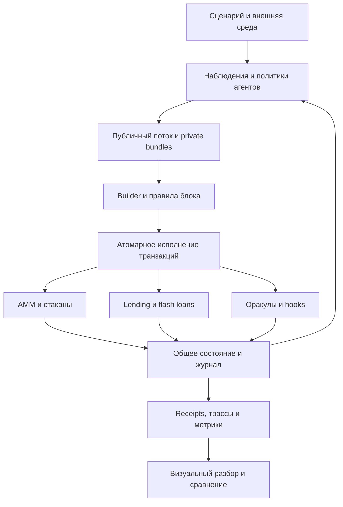

# Chainarium — спецификация проекта

**Рабочее название:** Chainarium.  
**Краткое описание:** интерактивная лаборатория моделирования DeFi-протоколов, блоков, исполнения транзакций и поведения агентов.  
**Версия документа:** 0.3  
**Дата обновления:** 2026-11-06  
**Статус:** рабочая спецификация; реализация описанных компонентов ещё не создана.  
**Основной язык ядра:** Rust.  
**Канонический путь в репозитории:** `docs/spec.md`.

Версия документа не является версией готовой программы. **`docs/spec.md` — главный источник общепроектных требований**, инвариантов, границ и приоритетов. Изменения архитектурных решений требуют явного согласования владельца проекта и записи причин по §23.2. До начала реализации исходные решения и их обоснования находятся в этой спецификации; отдельные ADR для них не создаются. Принятые подробные спецификации отдельных возможностей могут размещаться рядом с кодом или в OpenSpec, но не могут противоречить этому документу. При переносе из ChatGPT Library в Git-репозиторий нужно сохранить одну каноническую версию: копия в Library не синхронизируется с Git автоматически.

Решения ниже задают исходный вариант архитектуры и могут уточняться через управляемый процесс изменений. Принципы разработки и правила работы Codex определены в §23.

## 1. Цель и изменение масштаба

Проект моделирует взаимодействие торговых площадок, кредитных протоколов, оракулов, участников и механизма исполнения блоков. Пользователь создаёт сценарий, запускает его, наблюдает изменения состояния и сравнивает альтернативные правила.

Первоначальная идея симулятора одного AMM расширена до **модульной DeFi-лаборатории**. В центре архитектуры находятся общее состояние, составные транзакции, упорядоченное исполнение и объяснимые результаты. AMM становится одним из семейств подключаемых механизмов.

Подтверждённые пользователем направления:

- расширяемость и поддержка нескольких механизмов рынка;
- flash loans, lending и связанные процессы;
- учёт блоков и дальнейшие эксперименты с MEV;
- визуальное представление модели и причин происходящего;
- хранение спецификации в Markdown;
- проектное имя **Chainarium**;
- разработка через спецификацию, явно фиксируемые архитектурные решения, вертикальные срезы, независимые проверки и регулярные демонстрации;
- возможность подключения RL-политик без изменения семантики исполнения протоколов.

### 1.1. Основные вопросы

1. Как устройство площадки и доступная ликвидность влияют на исполнение сделок?
2. Как многошаговые операции связывают несколько протоколов?
3. Как заёмный капитал, проценты, оракулы и ликвидации меняют поведение участников?
4. Как доступ к информации, включение и порядок транзакций распределяют результат?
5. Какие последствия сохраняются после исполнения, а какие отменяются при revert?
6. Какие выводы устойчивы при изменении параметров и начальных условий?
7. Могут ли обучаемые политики принимать лучшие решения, чем воспроизводимые rule-based baseline, не используя недоступную в реальности информацию?

### 1.2. Конечный продукт

Локально запускаемое приложение с Rust-ядром, интерактивным интерфейсом, CLI и набором воспроизводимых сценариев. Пользователь может перейти от общего графика к отдельному блоку, транзакции, вызову протокола и изменению баланса. В перспективе то же ядро служит средой обучения и сравнительной оценки RL-политик: визуальная демонстрация, пакетный эксперимент и обучение не должны использовать разные экономические правила.

Полезность продукта определяется возможностью объяснить цепочку: **наблюдение участника → решение → отправленная операция → порядок исполнения → изменение состояния → экономический результат**.

Основной пользователь v1.0 — разработчик или технически подготовленный учащийся, исследующий устройство DeFi. Это объяснимая лаборатория с воспроизводимыми экспериментами; она не заявляется валидированным прогнозом реального рынка. Пользовательская приёмка строится вокруг задач: выбрать preset, запустить его, найти причину revert, изменить параметр, сравнить результаты, сохранить и воспроизвести эксперимент (§15.6).

## 2. Объём проекта и уровни готовности

### 2.1. Целевой состав версии 1.0

Все перечисленные ниже механизмы входят в целевой объём проекта. Поэтапность означает порядок реализации, а не их исключение.

| Подсистема | Исполняемый объём v1.0 | Существенные ограничения |
| --- | --- | --- |
| CPMM | Несколько пулов, swaps, комиссии, внесение/вывод ликвидности | Модель по мотивам V2; без полной совместимости ERC-20/EVM |
| StableSwap | Двухактивная модель, параметр усиления, swaps, базовые LP-операции | Без rate-bearing/rebasing токенов и полного Curve NG |
| CLMM | Диапазоны, ticks, активная ликвидность, переходы между диапазонами, комиссии позиций | Модель по мотивам V3; не вся контрактная периферия |
| Order book | Лимитные заявки, отмена, price-time matching, частичное исполнение | Детерминированная модель on-chain стакана |
| Routing | Маршруты по нескольким экземплярам площадок | Сначала ограниченная длина маршрута; глобальный оптимум не обещается |
| Lending | Supply, обособленный collateral, borrow, repay, redeem/withdraw, проценты, ограничения риска | Reference preset: один долговой актив и один вид залога; `C + D = S + E` |
| Liquidation | Проверка права, погашение долга, передача collateral, bonus, признание списаний | Исчерпание залога и остаточное списание атомарны; убыток сначала принимает E, затем S |
| Flash loans | Заём, callback с составными действиями, возврат и комиссия | Отдельный резерв provider; строгое погашение в той же транзакции |
| Oracles | Авторизованная публикация, observed/published time, sequence, свежесть, базовый TWAP | Возраст от observed_at; неполное окно TWAP даёт NotReady |
| Blocks | Timestamp, лимит ресурсов, mempool, nonce, порядок, receipts, комиссии | Профиль native-execution-v1; без воспроизведения Ethereum consensus/gas |
| MEV | Локальные searchers, bundles, builder policies, конкуренция за возможности | Эксперименты внутри модели, без отправки в реальную сеть |
| Hooks | Ограниченные обработчики вокруг экономических операций | Собственная модель расширений; не полный Uniswap V4 |
| Agents | Обычные трейдеры, LP, borrowers, arbitrageurs, liquidators, builders | Для v1.0 — объяснимые политики и контракт интерфейса; полноценное RL-обучение — отдельный этап после v1.0 |
| UI и CLI | Сценарии, шаги исполнения, графики, состояния, сравнения, экспорт | Одна вычислительная модель для обоих интерфейсов |

**M1 — первая техническая демонстрация:** один CPMM, исполнение, поздний отказ, rollback, fees/nonce и инспектор трассы. **M2 — первый составной DeFi-сценарий:** несколько механизмов, включая lending, flash loans, StableSwap и TWAP, вводятся отдельными принимаемыми срезами M2a–M2g (§21). CLMM, стакан, расширенный builder и оставшиеся представления добавляются до завершения целевой v1.0.

### 2.2. Статусы возможностей

У каждой возможности есть один из статусов:

- **Proposed:** возможность описана, но существенные правила остаются открытыми.
- **Specified:** определены состояние, переходы, единицы, права, ошибки и критерии приёмки; блокирующие семантические решения закрыты.
- **Implemented:** существует исполняемая реализация.
- **Verified:** пройдены проверки корректности заявленных случаев.
- **Demonstrated:** есть воспроизводимый сценарий и визуальное объяснение.

Статус назначается конкретной возможности со ссылкой на принятые требования. Версия 0.3 фиксирует решения владельца проекта, но не присваивает всем подсистемам статус Specified: открытые вопросы перечислены в §24. Реализации ещё нет; ни одна проверка из матрицы §20 не объявляется выполненной. `Extension contract` — обозначение архитектурного задела за пределами v1.0, а не отдельная ступень готовности. Наличие trait, конфигурационного поля или карточки в интерфейсе не считается реализацией механизма.

### 2.3. Следующие расширения

В архитектуре предусматриваются отдельные точки подключения для:

- EVM backend на REVM и сравнения с настоящими контрактами;
- исторических состояний, блоков и ценовых рядов;
- сетевой топологии, подробной propagation-модели, нескольких конкурирующих builders и reorg; заданные каналы private/public orderflow и модельные задержки уже входят в v1.0;
- off-chain биржи с неатомарным исполнением;
- обучаемых агентских политик и отдельного RL training/evaluation adapter, без изменения ядра;
- деривативов, мостов и нескольких цепочек.

Эти направления являются частью развития платформы. Их наличие в разделе расширений не означает, что полноценные модели уже входят в готовность v1.0.

## 3. Основные принципы

**P-01. Единое состояние.** Базовые активы имеют один авторитетный ledger. Протоколы не создают независимые копии денежных остатков.

**P-02. Все изменения объяснимы.** Любая запись состояния происходит через транзакцию или явно обозначенный системный переход блока.

**P-03. Решение отделено от исполнения.** Агент создаёт намерение на основании доступного наблюдения. Проверки и экономический результат определяются текущим состоянием при исполнении.

**P-04. Общая атомарность.** Вызовы разных on-chain протоколов внутри одной транзакции используют общий журнал изменений.

**P-05. Разные механизмы сохраняют свои правила.** От стакана и CLMM не требуется изображать CPMM с двумя резервами. Общими являются идентификация, вызовы, settlement и наблюдаемость.

**P-06. Детерминизм.** Одинаковые версия модели, конфигурация, начальное состояние и внешние входы дают одинаковый экономический результат.

**P-07. Числовая точность.** Подтверждённые балансы и обязательства рассчитываются целочисленно с явно заданным округлением.

**P-08. Цена имеет источник.** Внешняя котировка, oracle price, marginal price и execution price — разные величины.

**P-09. Явная точность модели.** Названия V2-like, V3-like и Aave-like обозначают выбранную экономическую модель, а не совместимость с конкретным deployment.

**P-10. Визуализация читает результаты.** UI не имеет собственного альтернативного расчёта финансового состояния.

**P-11. Политики агентов сменяемы.** Scripted, rule-based и обучаемая политика получают наблюдения по одинаковым ограничениям доступа и отправляют действия через тот же executor. Обучение не открывает обходные пути к состоянию.

**P-12. Доказуемый прогресс.** Каждый реализованный вертикальный срез проходит проверки инвариантов и завершается воспроизводимой демонстрацией, а не только добавлением интерфейса или нового модуля.

## 4. Архитектура



### 4.1. Ответственность компонентов

| Компонент | Ответственность | Чего он не делает |
| --- | --- | --- |
| Scenario | Начальное состояние, правила среды, версии моделей, расписания | Не меняет резервы ради заданного графика |
| World/State | Аккаунты, активы, экземпляры протоколов, состояние цепочки | Не принимает торговые решения |
| Executor | Вызовы, права, расходы ресурсов, rollback, commit | Не выбирает выгодный порядок транзакций |
| Protocol module | Собственные переходы состояния и финансовые проверки | Не обходит общий ledger |
| Builder | Выбор и порядок доступных транзакций и bundles | Не переписывает правила выбранных протоколов |
| Agent policy | Наблюдение, решение, построение команд | Не получает прямой mutable-доступ к миру |
| Oracle policy | Формирование и публикация доступной протоколам цены | Не считается автоматически истинной ценой |
| Metrics | Расчёт показателей из состояний и событий | Не создаёт дополнительные денежные потоки |
| UI/CLI | Управление экспериментом и представление результата | Не дублирует финансовое ядро |

### 4.2. Расширяемость в Rust

Начальная реализация использует Cargo workspace, статическую регистрацию моделей и версионированную конфигурацию. Подключаемый Rust-модуль реализует интерфейсы и регистрируется при сборке. Динамическая загрузка `.so` и произвольного пользовательского кода не требуется для v1.0.

Рабочие границы API:

- `ProtocolModel`: валидирует конфигурацию, исполняет поддерживаемые вызовы, проверяет свои инварианты, предоставляет снимок представления.
- `TradingVenue`: сообщает поддерживаемые виды котировок и исполнения; возвращает результат с конкретным `VenueId`, версией состояния и ограничениями. Результат различает фактически потраченный input, полученный output, комиссии, неиспользованный input и partial fill. Частичное исполнение стакана не маскируется под полностью выполненный AMM swap.
- `AgentPolicy`: получает `Observation` и выдаёт сериализуемые `Intent`/транзакции.
- `BlockPolicy`: выбирает кандидатов из доступного orderflow с учётом nonce, ресурса и ограничений bundles.
- `OracleModel`, `InterestRateModel`, `CostModel`: задают отдельные правила соответствующих подсистем.
- `ExecutionBackend`: исполняет транзакцию и формирует нормализованный receipt и trace.
- `DataSource`: предоставляет внешние события и начальные состояния, не меняя семантику исполнения.
- `ValuationPolicy`: версионирует источник, момент и единицу оценки, состояние Unpriced и расчёт MTM PnL (§14); не меняет lending oracle и доступную агенту информацию.

Точные Rust-сигнатуры определяются при реализации первого вертикального сценария. Обязательства интерфейсов из этой спецификации сохраняются независимо от выбора `enum`, generics или trait objects.

## 5. Сущности и состояние

### 5.1. Идентификаторы

- `ChainId`, `AssetId`, `AccountId`, `AgentId`, `ProtocolId`, `VenueId`, `PositionId`.
- `BlockId`, `TxId`, `CallId`, `OrderId`, `BundleId`, `RunId`.
- Пул не идентифицируется только парой токенов: одной паре могут соответствовать несколько моделей, комиссий и экземпляров.
- Актив включает chain namespace. Одинаковые символы не делают токены одним активом.

### 5.2. Активы, суммы и числовой wire-формат

`Asset` содержит идентификатор, decimals и метаданные отображения. `Amount` содержит актив и целое количество минимальных единиц. Рабочий выбор — точность уровня `U256` для сумм с расширенными промежуточными произведениями. Конкретный crate выбирается отдельно. Переполнение вызывает определённую ошибку; молчаливое насыщение и wrap-around запрещены.

Внутренняя конвенция `Price` — количество минимальных единиц quote за одну минимальную единицу base. Основной формат содержит `base_asset`, `quote_asset`, положительные целые `numerator` и `denominator`; знаменатель не равен нулю. Fixed-point представление допускается только с явно заданными scale и версией. Операция оценки `value(Amount, Price)` возвращает сумму в минимальных единицах quote. Человекочитаемая цена за целый токен преобразуется с учётом обоих decimals; прямое умножение количества atoms на отображаемую цену запрещено. Для HF все активы сначала оцениваются в одной единице. Базовая политика округляет оценку collateral вниз, долга вверх; правила и промежуточная точность являются частью версии модели.

JSON-интерфейсы Rust ↔ UI, команды и сохраняемые канонические данные передают все atoms десятичными строками. Так же передаются nonce, целые временные метки, номера блоков и другие потенциально большие счётчики, числитель и знаменатель цены. Беззнаковое значение записывается как `"0"` либо цифры без ведущих нулей, знака, экспоненты и разделителей. Знаковые результаты, включая PnL в выбранном активе оценки, используют десятичную строку с необязательным `-`; `-0` не является каноническим значением. Диапазоны проверяет parser соответствующего типа. Ограниченные метаданные вроде decimals могут быть JSON-числами в объявленном диапазоне схемы.

Такой формат не полагается на точность JavaScript Number: ограниченная область согласованной целочисленной точности распространённых JSON-реализаций описана в RFC 8259 [S18]. Контракт данных и восстановления зафиксирован в §23.2, DEC-03.

Например, `Amount` передаётся как `{"asset":"Q","atoms":"9007199254740993"}`, а цена — как `{"base_asset":"X","quote_asset":"Q","numerator":"100","denominator":"1"}`. Это цена в atoms, а не обещание цены 100 Q за целый X независимо от decimals.

UI использует `BigInt` и точные рациональные вычисления для сумм, цен и подготовки команд. Преобразование в JavaScript `Number` допустимо только для приблизительного графического представления; такое значение не используется для восстановления баланса, финансовой проверки или отправляемой команды. Пользовательский десятичный ввод преобразуется непосредственно в atoms по decimals и объявленному правилу округления. CSV служит аналитическому экспорту и не является каноническим форматом восстановления запуска.

`f64` разрешён для графиков, статистики и генерации сигналов поведения. До отправки команды сигнал преобразуется в целое количество по явно заданному правилу; экономическая команда сохраняет точный строковый формат. Граница воспроизводимости таких сигналов задаётся контрактом запуска (§13, §17).

Обязательные проверки формата: `2^53 - 1`, `2^53 + 1`, `U256::MAX`, выход за диапазон, активы с разными decimals и полный цикл Rust → JSON → UI → команда → Rust без изменения точного значения. Отрицательные суммы отклоняются; знаковый PnL проверяется отдельно.

### 5.3. Счета хранения

Собственные счета имеют участники, AMM, стаканы, lending reserves, fee collectors и другие контрагенты. Баланс протокола и его внутренний показатель reserves должны быть либо одной величиной, либо проверяемой парой с описанным смыслом различия.

Базовая токен-модель v1.0 поддерживает обычные переводы. Rebasing, fee-on-transfer, callbacks токенов и нестандартные ERC-20 возвращаемые значения требуют отдельной модели и не включаются молча.

В первом lending preset счета reserve cash и изолированного collateral escrow принимают и отправляют средства только через авторизованные переходы соответствующего протокола (§8). Прямой пользовательский `Transfer` на эти счета отклоняется: он не становится скрытым donation или recapitalization и не нарушает равенство `C + D = S + E`. `E` является бухгалтерской долей, а не дополнительными базовыми токенами; операции вывода treasury в первом preset нет. Это ограничение lending-счетов не распространяется автоматически на все AMM-счета. Flash provider имеет отдельный резерв согласно своему preset.

Защищённые reserve/escrow нельзя назначать `controlled_accounts` агента, sender пользовательской транзакции, счётом резервирования execution fee или fee account builder. Валидатор конфигурации запрещает такое совмещение: envelope/fee settlement не может обойти протокольный учёт. Lending reserve, escrow позиций и отдельный flash reserve имеют разные счета.

### 5.4. Права, позиции и контекст вызова

LP shares, диапазонная liquidity position, deposit shares и записи долга отражают права/обязательства. Их нельзя повторно прибавлять к обеспечивающим базовым активам при проверке сохранения. Первый lending preset использует прямой долг по позициям (§8.3); debt shares или индекс являются альтернативой только при сохранении этой семантики либо в другой версии модели.

Сценарий задаёт `AgentId → controlled AccountId[]`. Проверка выполняется при каждой отправке: произвольное поле `sender` не доказывает авторство. Для native-модели криптографическая подпись не требуется, но агент может отправить транзакцию только от управляемого аккаунта. Отдельные делегации задают явные область действий, аккаунты и допустимые средства; владение одной ролью не предоставляет все остальные права.

| Действие | Обязательные полномочия |
| --- | --- |
| Отправка транзакции | Агент управляет аккаунтом `sender` |
| Расход собственных средств | Право действовать от соответствующего аккаунта |
| Расход чужих средств | Allowance на конкретного spender либо явная ограниченная делегация |
| `Approve` | Владелец средств либо делегат с правом выдачи такого разрешения |
| `CancelOrder` | Владелец заявки либо его делегат |
| Управление LP-позицией, получение её fees | Владелец соответствующих shares/позиции либо его делегат |
| Вывод deposit shares или collateral, изменение использования collateral | Владелец позиции либо его делегат; дополнительно выполняются проверки протокола |
| `Borrow` | Заёмщик либо его делегат с правом открытия долга |
| `Repay` за другого участника | Допускается; плательщик должен иметь право расходования используемых средств |
| `Liquidate` | Любой участник при выполнении условий ликвидации и прав на средства погашения |
| `PublishOracle` | Назначенный publisher конкретного feed |
| Системное начисление процентов | Только executor в предусмотренной фазе `SystemTransition` |

Для вызовов различаются `origin`, `caller`, `callee` и receiver. `origin`, `caller` и `callee` устанавливает executor по реальному дереву вызовов, а не доверяет значениям из пользовательской программы. `origin` обозначает исходного отправителя и сам по себе не предоставляет вложенному вызову права тратить его средства. Обращение к протоколу не даёт автоматического доступа ко всем средствам отправителя.

В flash callback непосредственный `caller` — provider. Receiver проверяет ожидаемого provider и наличие активного ожидаемого займа с соответствующими параметрами. Произвольный вызов callback, подмена provider или ссылка на чужой `origin` не дают права распоряжаться средствами receiver или origin.

Негативные проверки охватывают подмену sender, отмену чужой заявки, управление чужой LP-позицией, неавторизованный oracle update, поддельный flash callback и попытку получить права через `origin`. Решение зафиксировано в §23.2, DEC-02.

## 6. Транзакции и атомарное исполнение

### 6.1. Конверт транзакции

Конверт содержит chain, sender, nonce, ресурсный лимит, цену единицы ресурса `p`, срок действия, адрес логического router/account и сериализуемую программу вызовов. Реальная криптографическая подпись в native-модели не нужна; авторство и права проверяются по §5.4. Числовые значения передаются в точном формате §5.2.

Примеры действий:

- `Transfer`, `Approve`, `SwapExactIn`;
- `AddLiquidity`, `RemoveLiquidity`, `CollectFees`;
- `PlaceLimitOrder`, `CancelOrder`, `TakeLiquidity`;
- `Supply`, `Withdraw` (погашение заданного количества deposit shares), `Borrow`, `Repay`, `Liquidate`;
- `DepositCollateral`, `WithdrawCollateral`, `SetCollateralUsage` — отдельные действия с escrow, не алиасы `Supply/Withdraw`;
- `FlashLoan { provider, assets, receiver, callback }`;
- `PublishOracle`, `AssertBalanceDelta`, `AssertCondition`.

Действия обращаются к конкретным экземплярам протоколов. Результат предыдущего вызова можно использовать как аргумент следующего через типизированную ссылку. Запрещено неявно использовать все ранее существовавшие средства кошелька там, где стратегия подразумевает только поступление текущей операции.

Вызовы представлены данными, а не произвольной Rust closure. Это нужно для повторного исполнения, аудита, визуализации и последующих адаптеров.

`AssertBalanceDelta` указывает аккаунт, актив и явно сохранённый baseline. Проверка остатка после закрытия flash scope не подменяется проверкой временного заёмного баланса. Окончательный net PnL учитывает непогашенные постоянные обязательства и fee settlement из receipt; внутритранзакционная проверка прибыли должна объявлять, какие расходы она покрывает.

### 6.2. Жизненный цикл и native-execution-v1

`native-execution-v1` — нормативный начальный профиль исполнения. Mempool admission и inclusion validation различаются (§11.3); поступление в mempool не резервирует канонические средства и не расходует nonce.

1. **Inclusion validation:** проверить формат, chain, авторство, параметры конверта, срок, точное совпадение nonce с текущим ожидаемым, возможность зарезервировать весь бюджет комиссии и вместимость заявленного лимита в оставшийся бюджет блока. Проверки выполняются на состоянии после предшествующих транзакций.
2. **Envelope effects:** зарезервировать у sender `resource_limit × p` в fee asset и израсходовать его nonce. Резерв недоступен экономической программе.
3. **Execution:** выполнить дерево вызовов в журналируемом состоянии, начисляя cost units перед соответствующими шагами.
4. **Protocol checks:** проверить ограничения в определённые каждым протоколом моменты.
5. **Settlement checks:** закрыть временные обязательства и проверить корректность учёта.
6. **Commit/Revert:** зафиксировать либо откатить изменения исполнения согласно исходу; envelope effects имеют отдельную границу отката.
7. **Fee settlement:** перечислить `used_units × p` на fee account builder этого блока и вернуть sender неиспользованный резерв.
8. **Receipt:** сохранить статус, расходы, подтверждённые события и ссылку на диагностическую трассу.

`p` — целое неотрицательное число atoms fee asset за unit. Fee asset и fee account builder разрешаются из проверенной конфигурации блока. Нулевое `p` допускает явно бесплатный учебный сценарий; расход ресурса и лимиты сохраняются. Плательщик — sender; base fee, burn и sponsorship в этом профиле отсутствуют. Переполнение при расчёте заявленного fee budget является ошибкой параметров конверта до включения. Reserve/refund и перечисление execution fee не порождают рекурсивные resource charges.

Начальная таблица `native-cost-v1`:

| Точка начисления | Cost units |
| --- | --- |
| Начало включённой транзакции | 100 |
| Вход в каждый вызов дерева исполнения, включая callback | 10 |
| Один перевод одного базового актива через ledger в экономической программе | 5 |
| Одна итерация solver | 1 |
| Один шаг перехода к следующему tick при CLMM swap | 1 |
| Один match заявок стакана | 1 |

Начисление выполняется **до** действия. Если остатка лимита недостаточно, действие не выполняется и исходом становится `ResourceExhausted`; `used_units = resource_limit`. Переходы внутри long-running loops имеют конечные пределы и учёт ресурса. Перед добавлением нового потенциально длинного цикла его предел и точки начисления фиксируются в версии cost model; перечисленные единицы не означают, что остальные циклы можно оставить неограниченными. Конверт с лимитом меньше базовых 100 units невалиден.

Таблица и точки начисления версионируются совместно: их изменение может поменять включение и PnL. UI-запросы и локальные симуляции не расходуют канонический ресурс транзакций; собственную вычислительную работу симуляции можно отражать отдельной статистикой. Во временном состоянии симуляции executor использует ту же таблицу, что и окончательное исполнение.

### 6.3. Границы отката и исходы

| Результат | Изменения протоколов | Execution fee | Nonce отправителя |
| --- | --- | --- | --- |
| Невалидная либо не включённая транзакция | Нет | Нет | Не расходуется |
| Включена, успешна | Фиксируются | `used_units × p` | Расходуется |
| Включена, `ProtocolRevert` | Откатываются | Фактически начисленные `used_units × p` | Расходуется |
| Включена, `ResourceExhausted` | Откатываются | Полный `resource_limit × p` | Расходуется |
| Только локальная симуляция | Нет канонических изменений | Только отдельная статистика симуляции | Канонический nonce не расходуется |
| `ModelError` | Запуск остановлен; текущий незавершённый блок не фиксируется | Нет вымышленных итоговых fees незавершённого блока | Сохраняется состояние последнего committed-блока |

Таблица задаёт native-профиль с Ethereum-подобной границей сохранения nonce и execution fee при обычном revert. Это не точный расчёт Ethereum gas. Изменения nonce внутренних вызовов/создаваемых сущностей относятся к своему откатываемому контексту.

Для v1.0 ошибка дочернего вызова по умолчанию прерывает составную программу. Ядро содержит вложенные checkpoints, чтобы позднее добавить явный `TryCall`. Неявное подавление ошибок запрещено.

Обычный protocol revert является результатом моделируемого поведения. Ошибка пользовательского JSON, невалидный числовой wire-формат или недопустимый конверт — ошибка входа/admission, а не `ModelError`. Нарушение безусловного бухгалтерского инварианта, невозможное внутреннее состояние, дефект арифметики/внутренней сериализации или повреждение checkpoint — `ModelError`: запуск останавливается с диагностикой, а незавершённый блок не публикует канонических частичных результатов. Их нельзя скрывать обычным revert. Предусмотренная моделью проверка диапазона пользовательского значения должна вернуть определённый отказ на соответствующем этапе, а не аварийно завершить корректную модель.

Падение HF ниже единицы, неприбыльная стратегия и признанный bad debt являются допустимыми экономическими состояниями. Они не нарушают безусловные инварианты программы. Ограничения открытия новых позиций и условия ликвидации проверяются соответствующими операциями.

### 6.4. Общий журнал

Журнал охватывает ledger, состояния всех затронутых протоколов, позиции, временные обязательства и состояние hooks. При откате не должно оставаться успешной записи только в одном из модулей составной операции. Envelope effects и fee settlement принадлежат журналу блока; transaction revert сохраняет предусмотренные effects, а отмена блока отменяет и их.

Сохраняются два представления:

- **Committed events/state:** изменения, действительно вошедшие в каноническое состояние.
- **Execution trace:** попытки, промежуточные значения, отклонённые и отменённые вызовы.

Отменённые swaps не входят в канонические объём торгов и комиссии LP. Затраченная стоимость включённой неудачной транзакции учитывается отдельно. Остановленный из-за `ModelError` запуск может сохранить диагностическую трассу незавершённого блока с явным признаком отсутствия commit.

Обязательные сценарии профиля: последовательные nonce; недостаточный fee budget; reserve, charge и refund; поздний protocol revert; исчерпание ресурса после успешных внутренних шагов; вместимость блока; повторная проверка кандидата после предыдущей транзакции; остановка по `ModelError` без частичного commit блока. Решение зафиксировано в §23.2, DEC-02.

## 7. Торговые механизмы

### 7.1. CPMM

Поддерживаются обычные exact-input swaps, настраиваемая комиссия и LP shares. Для одного входного актива используется точная рациональная формула с округлением output вниз; входная сумма целиком поступает на счёт пула. Базовый preset оставляет swap fee в пуле; protocol fee задаётся отдельно и по умолчанию отключена. Основа механизма — V2 [S1].

Минимальные проверки: достаточная ликвидность, положительный допустимый input, `min_out`, корректный учёт, неуменьшение произведения резервов для swaps в заявленных условиях. Ввод и вывод ликвидности имеют собственные инварианты.

До реализации LP-операций карточка `cpmm-v1` задаёт bootstrap, формулы mint/burn, направления округления, судьбу dust и состояние после последнего выхода. Положительный ввод, выпускающий ноль shares, отклоняется; предусмотрены пользовательские ограничения минимальных shares и выходных активов. Приёмка включает эти случаи отдельно от swap. Наличие заблокированной minimum liquidity, если она будет выбрана, явно учитывается в определении последнего выхода; правило полного погашения lending shares из §8.2 не переносится молча на AMM.

### 7.2. StableSwap

Двухактивная модель использует нормализованные balances и параметр amplification. Это самостоятельный invariant solver; замена на constant sum не считается реализацией StableSwap [S2, S3].

Специфицируются scale нормализации, округление, допуск и максимальное число итераций. Невыход на сходимость имеет определённую ошибку. Параметры и нормализация имеют model version.

Базовый preset предусматривает пропорциональное внесение/вывод ликвидности и swaps. Несбалансированные LP-операции можно добавить отдельной capability. Готовность требует сценария около равновесия и сценария сильного дисбаланса/depeg.

LP-карточка фиксирует начальные shares, округление, минимальные допустимые mint/burn, пользовательские min_shares/min_assets и остатки после последнего выхода. Положительный депозит с нулевым выпуском shares отклоняется. Эти численные правила и независимые ожидания утверждаются до реализации M2e.

### 7.3. CLMM

Состояние содержит sqrt-price, текущий tick, активную liquidity, индекс инициализированных ticks, изменения liquidity на границах, диапазоны позиций и fee growth. Swap проходит участки до границ и корректно изменяет активную ликвидность при их пересечении [S4, S5].

Позиция может перестать быть активной после выхода цены за диапазон. Общие balances пула не заменяют распределение ликвидности. Цена может находиться между ticks.

Комиссии позиции учитываются отдельно от вложенной liquidity; reinvest — отдельное действие. При отсутствии исполнимой ликвидности quote/исполнение возвращает определённый результат, а не бесконечную или выдуманную цену.

### 7.4. On-chain order book

Стакан имеет price levels, order IDs, владельцев, остатки объёма и блокировку соответствующих средств. Правило сопоставления — price-time с детерминированным tie-breaker. Временной приоритет определяется порядком успешного принятия заявки при on-chain исполнении, а не моментом поступления в mempool.

Поддерживаются:

- постановка и отмена лимитной заявки;
- частичное исполнение;
- GTC для стоящих заявок;
- IOC/FOK для входящего исполнения;
- явные правила maker/taker fees и округления.

On-chain стакан входит в общий атомарный контекст. Внешняя биржа с задержкой подтверждения — другой settlement domain и отдельный адаптер, даже если использует похожую структуру order book.

### 7.5. Маршрутизация

Router работает с графом активов и конкретных площадок. Для v1.0 достаточно перебора допустимых маршрутов ограниченной длины с оценкой результата и стоимости исполнения. Параллельное дробление ордера не обязательно для первого router.

Quote содержит `state_ref`, путь, ожидаемый результат и ограничения. При исполнении актуальное состояние проверяется заново. Для нескольких hops внутри одной транзакции результаты передаются между вызовами через общий ledger и ссылки на outputs.

Каждый hop использует фактический результат предыдущего. Политика маршрута определяет, допустимы ли partial fills и куда возвращаются остатки. При требовании полного исполнения недостаточный fill вызывает revert всей составной операции.

Маршрут с off-chain исполнением не маркируется атомарным. Оптимальность найденного пути указывается только относительно реализованного поиска и доступного графа.

### 7.6. Hooks и расширяемые правила

В v1.0 предусматриваются определённые точки вмешательства вокруг swap и изменения ликвидности. Примеры — dynamic fee, лимит объёма и отказ по условиям. Hook получает ограниченный контекст, расходует ресурс, а его состояние входит в общий rollback.

Наблюдатель событий и hook исполнения — разные API. Наблюдатель не меняет финансовое состояние. Разрешённые эффекты hook описываются capability и проходят через executor.

Это учебная модель расширений, вдохновлённая точками вызова V4 [S6]. Полные custom accounting и flash accounting V4 требуют отдельного механизма итоговых deltas и не считаются реализованными только за счёт callbacks.

## 8. Lending и ликвидации

### 8.1. Базовый preset и обязательное состояние

Первый native-preset `isolated-collateral-lending-v1` использует один долговой актив **Q** и один залоговый актив **X**. Залог хранится на отдельном escrow-счёте каждой позиции: его нельзя выдавать в долг, включать в cash кредитного резерва или повторно учитывать как требование кредиторов. `Supply(Q)` создаёт ликвидность кредитного резерва; внесение `X` в collateral escrow — другая операция. Это выбранная учебная модель, а не полная модель Aave. Решение принято в §23.2, DEC-01.

Ранний flash-provider имеет собственный cash-счёт, отдельный от lending reserve. Выдача flash loans из lending reserve возможна только как последующая явно заданная capability с собственными проверками; наличие обычного lending не включает её автоматически.

Обязательное состояние кредитного резерва:

- `C` — фактический cash в минимальных единицах Q на dedicated-счёте резерва.
- `D` — сумма признанного активного долга всех заёмщиков, включая уже начисленные целые единицы процентов.
- `S` — совокупное денежное требование deposit pool; это **не** сумма округлённых выплат отдельным вкладчикам.
- `E` — protocol equity, принимающая убыток первой; это бухгалтерская доля активов резерва, а не дополнительные токены.
- `T` — общее число deposit shares; число shares каждого вкладчика и статус резерва `Active / Bankrupt`.
- Для каждой позиции — escrow X, целый долг Q, переносимый дробный остаток процентов и флаг использования collateral.
- Ставка, время последнего начисления, LTV, liquidation threshold, close factor, liquidation bonus, supply/borrow caps, reserve factor и история списаний.

Во всех завершённых состояниях протокольного перехода выполняется точное равенство в минимальных единицах Q:

`C + D = S + E`, где `C, D, S, E >= 0`.

Залог X учитывается отдельно от этого баланса; его стоимость не прибавляется к `D`. Списанный долг остаётся в истории, но не входит в активное `D`. Dedicated lending cash и collateral escrow принимают и отдают средства только через авторизованные переходы соответствующего протокола: обычный `Transfer` напрямую на эти счета или из них отклоняется. Это исключает неучтённые donations и неявную рекапитализацию. Произвольный вывод `E` запрещён; операция treasury withdrawal не входит в этот preset. Правило не вводит общего запрета прямых переводов на счета всех AMM.

LTV для нового долга и liquidation threshold — разные параметры [S8]. Требуется `0 <= LTV <= LT <= 1`; ставки, лимиты, bonus и прочие числовые параметры входят в конфигурацию сценария. Условия на ranges параметров проверяются до запуска; скрытые значения в расчётном коде запрещены.

### 8.2. Операции и deposit shares

Поддерживаются `Supply`, `Withdraw`, внесение/вывод collateral, изменение его использования, `Borrow`, `Repay` и `Liquidate`. `Supply/Withdraw` относятся к депозитному пулу Q; collateral-операции — к escrow X. Новая задолженность ограничивается borrowing capacity по LTV и реальным cash. Вывод или отключение используемого collateral должны сохранять допустимый HF. Чувствительные операции используют актуальный lending oracle и правила stale/unavailable из §10; погашение и безопасное пополнение не требуют создания нового риска.

Deposit shares определяют пропорциональное право на `S`. Исходные правила `isolated-collateral-lending-v1`:

- При первоначальном `T = 0, S = 0` положительный депозит `a` минимальных единиц Q выпускает `a` shares: bootstrap **1 atom : 1 share**. Наличие отдельно учтённой `E` не меняет bootstrap и не даёт вкладчику права на equity.
- При `T > 0, S > 0` выпуск равен `m = floor(a * T / S)` по состоянию до депозита. Положительный депозит с `m = 0` отклоняется без перевода денег. Проверяется `min_shares`; при успехе `C += a`, `S += a`, `T += m`.
- Вывод задаётся фиксированным числом shares `m`, принадлежащих вызывающему. Выплата `a = floor(m * S / T)`; если сжигаются все `T` shares, выплачивается всё `S`. Проверяется `min_assets` и `C >= a`; при успехе `C -= a`, `S -= a`, `T -= m`.
- При нехватке cash вывод отклоняется без сжигания shares. Округлённая невыплаченная доля остаётся внутри `S`, а последний вкладчик получает её при полном погашении. Отдельный токен или денежный доход из округления не создаётся.
- Состояние `T = 0, S > 0` недопустимо. `S = 0, T > 0` после убытка означает банкротство: обычный новый `Supply` запрещён, деление на нулевую стоимость shares не выполняется. Денежного требования для обычного вывода нет; существующие shares и история сохраняются. Автоматического перезапуска пула, страховки или рекапитализации этот preset не содержит; recovery требует отдельного механизма и версии правил.

`Borrow(q)` переводит реальные Q заёмщику и изменяет `C -= q`, его активный долг и `D += q`. `Repay(q)` принимает не больше фактического активного долга: погашенная сумма `p` изменяет `C += p`, долг позиции и `D -= p`; излишек не удерживается. `S` и `E` при обычных borrow/repay не меняются. Полное закрытие долга отдельно обрабатывает дробный остаток процентов по §8.3.

Направление округления задаётся каждой операцией отдельно. Различие deposit/redeem и mint/withdraw встречается в ERC-4626 [S19], но совместимость с этим стандартом и все его методы для native-preset не обещаются. Собственная политика убытков также не выводится из ярлыка «Aave-like»: сравнение с реальным протоколом требует конкретной версии и закреплённого эталона (§20.4).

### 8.3. Проценты

Reference native-профиль начисляет проценты один раз на границе модельного блока как отдельный `SystemTransition` перед пользовательскими транзакциями. Используются состояние и ставка конца предыдущего блока и фиксированный временной интервал. Начисление не зависит от количества `quote` или обновлений UI; оно входит в журнал блока и отменяется при block rollback. Revert отдельной пользовательской транзакции не отменяет уже применённое системное начисление.

Для первой версии выбраны **прямой целый долг каждой позиции**, fixed-point scale `M = 10^18` и ставка `r` за секунду, представленная целым числом в этом scale. Временной интервал `dt` — положительное целое число секунд. Внутри одного блока применяется простое начисление; между блоками ранее признанный целый процент входит в базу следующего начисления. Для позиции с долгом `d` и переносимым остатком `0 <= z < M`:

`n = d * r * dt + z; i = floor(n / M); z_next = n mod M; d_next = d + i`.

Промежуточные произведения используют расширенную точность с проверкой диапазона. Сумма `I = sum(i)` — фактическое целое увеличение активного долга резерва. Сначала определяется именно `I`, затем распределяется доход. Для `reserve_factor = f / M`, `0 <= f <= M`, при наличии вкладчиков:

`P = floor(I * f / M); D += I; S += I - P; E += P; C` не меняется.

Если deposit shareholders отсутствуют (`T = 0`, следовательно `S = 0`), весь `I` относится в `E`: доход не начисляется несуществующим вкладчикам. Распределение выполняется один раз для совокупного `I`, а не отдельно с независимым округлением по каждому вкладчику.

Дробный остаток `z` переносится между блоками и сохраняется при частичном погашении. Он ещё не является признанным целым долгом и не включается в `D`, `S` или `E`. При полном погашении либо полном списании долга остаток меньше одного atom аннулируется как явно отражённое событие округления; токены или отдельные claims при этом не создаются. Debt shares или индексы могут заменить прямой учёт только при сохранении этой семантики либо в новой версии модели.

Поддерживаются постоянная ставка и utilization-based модель с точкой перегиба. Конкретные ставки, точка перегиба и формула их расчёта фиксируются в конфигурации/спецификации rate model до его реализации. Они возвращают `r` в указанном scale и не меняют правила признания и распределения `I`. Будущий lazy accrual должен начислять внутри протокольного вызова с его rollback; смешивать его с начислением на границе блока в одном экземпляре нельзя.

### 8.4. Health factor, ликвидация и признание убытка

Для общей модели в единой единице оценки:

`HF = sum(collateral_amount_i * oracle_price_i * LT_i) / sum(debt_amount_j * oracle_price_j)`.

Для первого preset знаменатель — активный долг Q, а числитель — оценка escrow X в Q с LT. Оценки и округления следуют §5.2. При нулевом долге возвращается отдельное состояние `NoDebt`. `HF < 1` даёт право на liquidation, но не запускает её автоматически и само по себе не означает признанный бухгалтерский убыток [S9]. Для HF используется lending oracle, а не исследовательский valuation feed из §14.

Ликвидатор отправляет транзакцию, переводит допустимую сумму Q в резерв, уменьшает активный долг и получает реальные X из collateral escrow с bonus. Объём ограничивается close factor, остатком долга, доступным collateral, балансом/разрешениями ликвидатора и правилами округления. Продажа полученного X — отдельный исполняемый вызов; наличие reference price не гарантирует её результата.

Пока collateral не исчерпан, низкий HF и оценка возможного дефицита отражаются как риск, но не уменьшают `D`, `S` или `E`. После исчерпания collateral непогашенный остаток активного долга позиции признаётся убытком `L`. **Ликвидация, исчерпавшая collateral, и списание остатка образуют один атомарный переход:** между ними нельзя выполнить withdrawal, начисление или другую операцию и нельзя зафиксировать промежуточное состояние как отдельный результат.

Признание убытка выполняется в той же единице Q:

`e = min(E, L); D -= L; E -= e; S -= L - e; C` не меняется.

Сначала расходуется equity, затем уменьшается совокупное требование вкладчиков. Списание не меняет число deposit shares: loss отражается в их стоимости. Долг закрытой позиции исключается из активного `D` и будущего начисления; размер и причина списания сохраняются как история bad debt и не вычитаются из баланса повторно. Если после уменьшения `S` оно равно нулю при оставшихся shares, резерв переходит в `Bankrupt` с правилами §8.2. Автоматические recoveries, выплаты страховки и внешняя рекапитализация отсутствуют.

### 8.5. Числовой бухгалтерский fixture

В этом fixture у Q и X `decimals = 0`, поэтому приведённые целые величины одновременно являются atoms и целыми токенами. Один вкладчик первоначально получает 100 shares за 100 Q. Заёмщик блокирует 6 X; исходная свежая oracle price равна 20 Q/X, LTV = 0.75 и LT = 0.8, поэтому borrow 80 Q допустим. Для одного проверяемого интервала задаются `dt = 1` секунда, `r = 0.125 * M`, нулевой дробный остаток и reserve factor = 20%: долг 80 Q получает ровно 10 Q процентов. Это аналитические параметры проверки, а не рыночные ставки.

В блоке B выполняются Supply, внесение collateral и Borrow; исходная цена 20 Q/X уже доступна и свежая. В блоке B+1 ровно через одну секунду выполняется единственное начисление I = 10 Q, затем в указанном порядке `PublishOracle(11 Q/X) → Liquidate/write-off → Withdraw(25 shares)` в этом же блоке. Во всех конвертах этого бухгалтерского fixture `p = 0`, а лимитов ресурса достаточно для шагов; проверка ненулевой execution fee выполняется отдельно в §20.3. Дополнительного блока с повторным начислением между строками таблицы нет.

После начисления публикуется свежая цена 11 Q/X: `HF = 6 * 11 * 0.8 / 90 < 1`. При close factor = 100% и bonus = 10% погашение 60 Q передаёт все 6 X: `60 * 1.10 / 11 = 6`. У ликвидатора есть достаточные Q и разрешение на перевод. Остаток долга 30 Q списывается в том же атомарном переходе.

| Состояние | C | D | S | E | Deposit shares T |
| --- | ---: | ---: | ---: | ---: | ---: |
| Supply 100 Q, затем borrow 80 Q | 20 | 80 | 100 | 0 | 100 |
| Начислены I = 10 Q; P = 2 Q | 20 | 90 | 108 | 2 | 100 |
| Подшаг liquidation: погашены 60 Q, переданы 6 X | 80 | 30 | 108 | 2 | 100 |
| Подшаг write-off L = 30 Q; итог той же liquidation | 80 | 0 | 80 | 0 | 100 |
| Погашены 25 из первоначальных 100 shares; выплата 20 Q | 60 | 0 | 60 | 0 | 75 |

Две строки liquidation/write-off показывают диагностические подшаги **одного** перехода. Committed-состояние после liquidation — только строка после write-off. В каждой строке выполняется `C + D = S + E`; supply, borrow, liquidation repayment и redemption сопровождаются соответствующими ledger-переводами. Flash funding для этого бухгалтерского fixture не требуется и не создаётся неявно.

## 9. Flash loans

### 9.1. Семантика

Flash loan — scoped-вызов внутри одной транзакции:

1. Кредитор проверяет ликвидность и правила доступа.
2. Выдаёт principal получателю.
3. Создаёт временное обязательство.
4. Вызывает callback с вложенной программой действий.
5. Получает principal и fee согласно объявленному settlement.
6. Закрывает обязательство перед успешным возвратом из вызова.

Комиссия параметризуется. Недостаточный возврат приводит к revert; успешные временные изменения других on-chain модулей в этом scope также откатываются. Граница строгого механизма соответствует repay-режиму flash loan [S7].

### 9.2. Ограничения

- Flash debt не переносится между транзакциями или блоками.
- Две транзакции одного bundle не могут совместно закрывать один flash loan.
- Вложенные flash loans разрешаются только при поддержке конкретных providers; обязательны лимиты глубины вызовов и ресурса.
- Ограничение reentrancy принадлежит экземпляру протокола. Глобальный запрет callbacks несовместим с механизмом.
- Преобразование flash loan в обеспеченный постоянный долг — отдельная будущая операция, не неявная запасная ветка строгого режима.
- Сделка на внешней бирже не включается в атомарный on-chain scope.

### 9.3. Обязательные демонстрации

**Арбитраж:** flash loan Q → swap Q/X в площадке A → swap X/Q в площадке B → возврат Q и fee → остаток на счёте стратегии.

**Ликвидация:** flash loan долгового актива → погашение части чужого долга → получение collateral → on-chain продажа collateral → возврат и fee.

Оба сценария содержат успешный вариант и вариант с недостаточным результатом, показывающий полный откат состояния протоколов и отдельно расходы включённой попытки.

Для первых составных сценариев `strict-flash-provider-v1` использует собственный резерв, отдельный от lending cash. Совместное использование lending cash для flash loans допускается только будущей явной capability с учётом временных требований. Контекст и проверка callback определены в §5.4.

## 10. Цены и оракулы

### 10.1. Источники, публикация и свежесть

Различаются:

- внешний reference price среды;
- опубликованный oracle price;
- котировка конкретной площадки;
- фактическая цена исполнения.

Обновление внешней цены не переписывает автоматически резервы или oracle storage. Oracle publisher создаёт определённый сценарием update; в базовом варианте он включается в блок как отдельная транзакция. Публикация разрешена только назначенному publisher конкретного feed (§5.4).

Запись оракула содержит feed и пару активов, точную цену в формате §5.2, `source_id`, `observed_at`, `published_at`, монотонный `sequence` и update ID. `observed_at` — логическое время наблюдения источника; `published_at` устанавливает executor по timestamp блока успешного включения. Publisher не может подменить время успешной публикации. Источник цены — явная часть модели, как и в интерфейсах реальных oracle consumers [S10].

При успешном `PublishOracle` проверяются назначенный publisher, соответствие feed/source/пары/единиц, положительность цены, `observed_at <= published_at`, `sequence > previous.sequence` и `observed_at >= previous.observed_at`. Для первой публикации ограничения относительно previous отсутствуют. Обновление с более старым наблюдением или неповышенным sequence не перезаписывает новое; одинаковый `observed_at` с новым sequence допускается, но не освежает возраст цены. Нарушение проверки в исполняемой транзакции даёт protocol revert.

Возраст вычисляется как `age = current_block_timestamp - observed_at`, задержка публикации — как `publication_lag = published_at - observed_at`. Цена свежая при `age <= max_age`, где `max_age` задаёт потребитель. Новая публикация старого наблюдения не делает его свежим. Корректное, но задержанное обновление может быть сохранено уже stale; факт хранения не разрешает чувствительные операции по нему. Удаление старых сообщений и принятие новых не подменяют эти проверки порядка.

Это временная семантика Chainarium. Поля внешних интеграций требуют явного сопоставления: например, Chainlink описывает `updatedAt` как время обновления round [S20], что не задаёт автоматически наш `observed_at`. Решение о временных отметках и порядке updates принято в §23.2, DEC-04.

Базовые варианты: external feed с задержкой, явно небезопасный spot feed для эксперимента и TWAP с документированным окном [S17]. Агент может видеть другую цену и другую задержку, чем lending protocol. Интерфейс показывает обе, время наблюдения, публикации, age, lag и цену, фактически использованную при проверке.

### 10.2. Доступность операций при stale или отсутствующей цене

Политика определяется потребителем. Первый lending preset использует следующие правила для необходимых операции цен; отсутствующая либо невалидная пригодная цена закрывает те же чувствительные операции, что и stale:

| Операция | Stale / отсутствующая пригодная цена |
| --- | --- |
| Открытие или увеличение долга (`Borrow`) | Запрещено |
| Вывод или отключение используемого collateral при наличии долга | Запрещено |
| `Liquidate` | Запрещено |
| `Repay`, в том числе за другого заёмщика | Разрешено с обычными проверками средств и долга |
| Пополнение collateral | Разрешено с обычными проверками средств и позиции |
| `Supply` | Разрешено с обычными проверками протокола |
| Погашение deposit shares, не используемых как collateral | Разрешено при достаточной свободной ликвидности и праве на shares |
| Вывод collateral у позиции без долга | Разрешено без оценки цены при остальных выполненных проверках |

Это выбранное правило native-модели, а не универсальное поведение всех реальных протоколов. В первом preset collateral изолирован от доходных supply shares (§8), поэтому пополнение collateral и `Supply`, как и их выводы, являются разными переходами.

### 10.3. Базовый TWAP

До завершения среза M2f реализуется baseline TWAP по накопленной цене и логическому времени. Для выбранного источника определяются положительная цена `p(t)` в согласованных единицах и окно `W > 0`. При кусочно-постоянной цене accumulator хранит точный рациональный интеграл `C(t) = integral(p(s) ds)`; `TWAP(t, W) = (C(t) - C(t - W)) / W`. Усреднение по числу samples не является реализацией этого контракта. Преобразование точного результата к версии fixed-point, если она выбрана, выполняется один раз по объявленному правилу.

Предыдущая действующая цена взвешивается временем до следующего успешного изменения. Например, цена 100 в течение 30 секунд и 200 в течение следующих 30 секунд даёт TWAP 150. Несколько успешных операций при одном timestamp имеют нулевые интервалы между собой; последняя успешная цена определяет последующий временной интервал. Промежуточная цена, впоследствии отменённая revert, не попадает в канонический accumulator или историю. Обновления состояния accumulator выполняются через общий журнал; read-only запрос может вычислить проекцию на запрошенное доступное время без канонической мутации.

Для получения значения требуется пригодная история на всём окне. При недостаточной истории или промежутке без определённой цены возвращается `NotReady`, а не среднее по укороченному окну и не выдуманная цена. Нулевой интервал не добавляет вес; нулевое окно невалидно. Конкретная структура хранения истории и checkpoints может выбираться в M2f при сохранении точного значения на границах окна, в том числе между samples.

При публикации готового TWAP его `observed_at` равен концу использованного окна, а `published_at` устанавливается общим правилом включения. Повторная публикация того же окна не омолаживает результат. Источник цены, ширина окна и доступная история фиксируются в oracle preset до реализации M2f; данные будущих интервалов недоступны расчёту.

Минимальные проверки: разные длительности интервалов; пример 100/200 → 150; `NotReady` при неполном окне; нулевой elapsed time; несколько операций одного timestamp; откат промежуточной цены; отсутствие изменений от query/UI. Для публикаций отдельно проверяются устаревшее наблюдение с новой публикацией, нарушение sequence, future-dated observation и неавторизованный publisher.

## 11. Блоки, время и orderflow

### 11.1. Native chain profile

Блок содержит номер, parent ID, timestamp, builder ID и fee account, ресурсный лимит, выбранные fee parameters, системные переходы, упорядоченные транзакции и receipts.

Начальный профиль — `native-execution-v1` с таблицей `native-cost-v1` (§6.2). Интервал блока и block resource limit задаются конфигурацией. Цена ресурса выражается в выбранном fee asset; перевод в общую единицу оценки выполняется отдельно. Модельные units не называются измеренным Ethereum gas.

Перед включением **весь заявленный лимит транзакции** должен помещаться в оставшийся бюджет блока. После исполнения из бюджета вычитается фактически начисленный `used_units`, включая расходы reverted/exhausted транзакций. Меньший ожидаемый расход из симуляции не позволяет включить конверт с чрезмерным заявленным лимитом. Mempool admission и локальные симуляции сами по себе не расходуют канонический ресурс блока.

### 11.2. Порядок одного раунда

1. Продвигается логическое время и обновляется внешняя среда.
2. Участники получают разрешённые наблюдения последнего committed-состояния и доступных внешних событий.
3. До cutoff блока обрабатывается очередь событий: отправка → доставка разрешённым участникам → их реакция → доставка новых сообщений. В том числе searcher может отреагировать на свежую pending-транзакцию до включения в тот же блок. Очередь учитывает видимость, задержку и вычислительный бюджет реакции; committed on-chain состояние на этой фазе не меняется.
4. Builder выбирает кандидатов и формирует контекст следующего блока.
5. На рабочем состоянии применяются определённые профилем системные переходы, включая процентное начисление.
6. Builder симулирует выбранный порядок тем же executor, который используется для окончательного исполнения.
7. Последовательность исполняется, блок фиксируется, публикуются receipts и новые наблюдения.

Агенты могут прогнозировать следующий контекст в собственной симуляции, но не читают скрытое каноническое будущее. Порядок событий детерминирован: сначала логическое время доставки, затем стабильный ID события. Назначение ID и порядок генерации одновременных событий входят в версию scheduler; обход `HashMap`, wall-clock и порядок UI-запросов не участвуют в выборе победителя.

В M0 фиксируется контракт порядка событий и восстановления scheduler. До реализации среза M4, вводящего реакции на pending orderflow, фиксируются включительность cutoff, конечные модельные бюджеты/пределы цепочек реакций и исход их исчерпания, в том числе при нулевых задержках. Эти параметры должны быть явными в профиле и сценарии до реализации зависимых переходов; wall-clock timeout не определяет экономический результат. Полноценная сетевая топология и propagation остаются расширениями; v1 использует заданные каналы видимости и модельные задержки.

Каждый кандидат блока начинается от одного и того же parent snapshot и применяет системные переходы ровно один раз в своём временном контексте. Финальное исполнение использует свежий контекст того же parent либо фиксирует уже проверенный результат. Нельзя повторно начислять проценты поверх состояния, уже изменённого симуляцией кандидата. `ModelError` прекращает запуск без commit текущего блока (§6.3).

### 11.3. Mempool admission и inclusion validation

Учитываются sender/nonce, arrival time, deadline, fee bid, ресурс, канал доставки и видимость. Все агенты не получают автоматически доступ ко всем pending-транзакциям. Поступление в mempool не изменяет канонические балансы, fee reserves и nonce.

| Проверка при admission | Результат |
| --- | --- |
| Неверный формат, chain, авторство или параметры конверта; истёкший deadline | Отклонение без fees и расхода nonce |
| `nonce < expected_nonce` | Устаревший кандидат; отклонение/удаление |
| `nonce > expected_nonce` | Ожидание предшествующих nonce в пределах лимитов mempool |
| `nonce == expected_nonce`, но недостаточно средств для полного fee budget | Ожидание в пределах лимитов mempool; никаких канонических резервов |
| `nonce == expected_nonce` и fee budget доступен | Кандидат на включение; это ещё не гарантия включения или успеха |

Очередь имеет явно заданные пределы размера/времени хранения и детерминированную политику вытеснения, фиксируемые до среза M4. Непосредственно перед включением проверяются актуальные nonce, fee budget, срок и вместимость resource limit в оставшийся бюджет блока, **после** всех предшествующих транзакций и системных переходов. Средства, полученные от предыдущей транзакции, могут сделать кандидата исполнимым; ранее доступные средства не гарантируют его последующую исполнимость.

Несколько кандидатов с одним sender/nonce могут находиться в очереди в пределах её лимитов. Builder выбирает согласно своей политике; базовый tie-breaker для равного основного приоритета — `arrival_time`, затем стабильный `TxId`. Включение одного кандидата, в том числе завершившегося protocol revert или исчерпанием ресурса, расходует nonce; остальные становятся stale. Этот профиль не вводит скрытое правило автоматической замены по повышенной fee bid.

Различие исполнимых и ожидающих транзакций имеет аналог в `pending/queued` интерфейсе Geth [S21]; конкретные правила Chainarium задаются таблицей выше, а не автоматически наследуются от клиента реальной сети.

Структурно невалидный кандидат отбрасывается builder до включения. Невалидный конверт внутри уже заявленной последовательности означает невалидность кандидата блока, а не receipt с protocol revert. Protocol revert валидно включённой транзакции является обычным receipt, если политика её включения это допускает. Builder проверяет конфликтующие nonce и соответствующие ограничения bundles (§12) на актуальном временном состоянии.

### 11.4. Reorg как расширение

Journal блока должен позволять отменить его on-chain последствия, включая fees и nonce. Это иной масштаб отката, чем transaction revert.

Реализация конкурирующих ветвей и fork choice добавляется отдельным milestone. Уже подтверждённые off-chain исполнения не отменяются автоматически вместе с reorg цепочки. Полный checkpoint запуска, включающий память агентов и сообщения, также отличается от отмены только on-chain последствий блока (§15.3).

## 12. MEV и bundles

MEV рассматривается как результат выбора включения, исключения и порядка операций при заданных информации и ограничениях [S11, S12].

### 12.1. Роли

- Searcher наблюдает разрешённый поток и ищет конкретные возможности.
- Builder выбирает последовательность под ресурсные ограничения и свою цель.
- Обычный пользователь отправляет транзакции по выбранному каналу.
- Oracle publisher и liquidator дают отдельные виды orderflow.

### 12.2. Bundle

Bundle содержит упорядоченные транзакции, целевой блок/диапазон, срок, bid и политику разрешённых reverts. Сначала поддерживается запрет interleaving внутри принятого bundle.

Денежный bid обеспечивается исполняемым переводом либо правилом fee settlement с конкретным плательщиком. Само поле предложения не создаёт доход builder. В отчёте одна выплата учитывается однократно, даже если она представлена одновременно в transaction fee и показателе bundle revenue.

Builder проверяет bundle на временном состоянии. Отклонённый кандидат не меняет канонический ledger и не платит on-chain fees; стоимость поиска/симуляции может учитываться отдельной метрикой.

**Bundle не является одной транзакцией.** При разрешённом revert одной включённой транзакции предыдущие успешно исполненные транзакции сохраняют результаты. Атомарное включение группы и атомарный rollback одной транзакции — разные механизмы [S13].

### 12.3. Политики v1.0

- FIFO с проверкой nonce.
- Заранее заданный порядок для контролируемого эксперимента.
- Простая политика по fee bid.
- Ограниченный greedy builder для обычных транзакций и bundles с повторной проверкой конфликтов на актуальном временном состоянии.

Builder учитывает ресурс, пересечение транзакций между bundles и конкурирующие nonce. Название «максимизатор» не используется без доказательства или полного поиска в заданном пространстве.

### 12.4. Сценарии

Базовые стратегии: multi-venue arbitrage, backrun и конкуренция liquidators. Сравниваются публичный и private orderflow, задержки, включение и результат после модельных издержек.

Другие стратегии, включая front-run/sandwich в контролируемом учебном сценарии, могут добавляться как явно обозначенные политики. Это не обязательное условие первой проверки MEV-архитектуры.

## 13. Агентская модель

Каждый агент имеет баланс/позиции, доступную информацию, внутреннее состояние, расписание решений, политику и допустимые действия.

Базовые политики:

- сценарный и случайный пользовательский orderflow;
- пассивный LP и LP с заданным расписанием изменения позиции;
- borrower с заданным спросом и правилами погашения;
- arbitrageur с ограниченным капиталом и опциональным flash funding;
- liquidator, учитывающий oracle health и исполнимую стоимость продажи collateral;
- market maker для стакана;
- oracle publisher, searcher и builder.

Политика получает `Observation`, а не полный `World`. Наблюдение указывает номер/время состояния, видимые позиции и доступные сообщения. Нельзя выводить прибыль из знания будущего external price или private orderflow, которого у агента нет.

### 13.1. Случайность

Отдельные потоки RNG используются для среды, заявок, агентов и scheduler. Для сравнений сохраняются общие внешние последовательности или независимые именованные потоки.

При сравнении порядка фиксируются заявки. При сравнении стратегий фиксируется среда, а фактические решения могут различаться. Одинаковый seed сам по себе не является достаточным доказательством сопоставимости.

### 13.2. Обучаемые политики и Reinforcement Learning (RL)

**Статус:** архитектурно предусмотрено в v1.0; обучение и оценка обученных политик — самостоятельный этап **M6 / RL-01** после стабилизации базовой среды. RL не используется для расчёта резервов, долгов, комиссий, транзакционной атомарности или выбора «правильного» результата. Это только альтернативная `AgentPolicy`, которая принимает решение по разрешённому наблюдению.

**Контракт среды** (необязательно в точности в терминах Python, но с эквивалентной семантикой):

- `reset(scenario_id, seed, policy_config) -> Observation, Info`: воспроизводимое начальное состояние эпизода, включая память агентов, RNG и очереди.
- `step(Action) -> Observation, Reward, terminated, truncated, Info`: применение допустимого действия через общую модель блоков и транзакций. Один RL-step явно соответствует решению агента, блоку или иному фиксированному временному шагу; семантика задаётся версией среды.
- `Observation`: только информация, доступная выбранной роли, с указанием времени, задержек и маской допустимых действий. Полный `World` доступен исследователю для диагностики, но не политике.
- `Action`: типизированная команда из предусмотренного множества; исполнитель проверяет балансы, nonce, ресурс, авторизацию и протокольные ограничения. Недопустимое действие обрабатывается по заданному правилу, а не исправляется скрытой выгодной сделкой.
- `Reward`: явно версионированная функция результата, с учётом комиссий, стоимости операций, открытых позиций и риска; не подменяет истинные денежные потоки или состояния протоколов.
- `Info`: диагностическая информация, связь с `RunId` и trace для исследователя; поля, недоступные агенту, не переносятся в `Observation`.

**Первое целевое применение — RL-агент управления LP-позицией CLMM:** решение `hold / reposition / add / remove liquidity`, наблюдение о цене, прошлой волатильности, диапазоне, собственном inventory и комиссиях. Reward сравнивает изменение стоимости позиции при заданном риске и расходах. Простая фиксированная стратегия и rule-based ребалансировка обязательны как baseline. Следующие возможные задачи: market making в стакане, управление collateral, поиск арбитражных маршрутов и политика searcher/builder (последние требуют отдельной оценки информационных преимуществ и многоагентной конкуренции).

**Инструментальная граница:** базовый `EnvironmentAdapter` реализован поверх Rust-ядра; первоначальное обучение допустимо через Python-адаптер (например, PyO3/maturin + Gymnasium) и внешний trainer. Конкретные библиотеки обучения выбираются отдельно, не закрепляются за расчётным ядром. Пакетное исполнение эпизодов допускает параллелизм независимых запусков, а не конкурентную мутацию одного мира.

**Протокол оценки:** фиксировать версию модели, сценарии, конфигурации политик, seed, набор обучающих сред, независимые validation/test-среды, полный состав издержек, reward и метрики. Сравнивать RL с минимум двумя понятными baseline по нескольким независимым запускам; публиковать распределения результата и показатели риска, а не только лучший эпизод. Проверять отсутствие future information и утечки скрытого состояния. Обученная политика, выигрывающая лишь на известных seeds, не считается подтверждённым улучшением.

**Что не обещается на v1.0:** собственный RL-фреймворк, обучение внутри браузера, стабильная прибыль на реальном рынке, multi-agent self-play и доказательство, что выученная стратегия переносится на реальную сеть.

## 14. Учёт и метрики

### 14.1. Сохранение активов

Для каждого базового актива сумма по счетам согласуется с начальной эмиссией, явными mint/burn и внешними потоками. Включаются escrow стакана, отдельные collateral escrow, lending cash, flash-provider cash и fee collectors. Переоценка портфеля при изменении цены не считается выпуском токенов. Shares, позиции и receivables не прибавляются к обеспечивающим их базовым токенам при проверке token conservation.

Для первого lending preset отдельно проверяется точное `C + D = S + E` из §8. Активное `D` не включает списанный долг, `S` обозначает требование всего депозитного пула, equity не является дополнительными токенами, а collateral X находится вне этого баланса. Accounting residual должен быть равен нулю; допустимые округления отражаются указанными правилами, а не маскируются допуском бухгалтерского равенства.

Внешняя reference price является источником оценки и наблюдений, а не контрагентом с бесконечной ликвидностью. Для покупки или продажи по внешнему сигналу требуется исполнимая площадка, обеспеченная заявка другого участника либо явно заданная модель внешнего исполнения. Обе ноги арбитража должны иметь проверяемое settlement.

### 14.2. Набор показателей

| Область | Показатели |
| --- | --- |
| Исполнение | Input/output, цена сделки, quote/actual difference, fee, cost units, revert reason |
| Площадка | Исполнимая глубина, ликвидность, объём, комиссии, состояния модели |
| LP | Стоимость позиции, полученные/неполученные комиссии, изменение inventory, сравнение с сопоставимым hold |
| Lending | C/D/S/E, utilization, ставка, активный debt, collateral, HF, liquidations, история списаний, стоимость deposit shares и cash, доступный для их погашения |
| Flash loan | Principal, fee, вложенные действия, погашение, результат цикла |
| Block | Ресурс, включённые и отклонённые кандидаты, порядок, latency |
| MEV | Результат searcher, builder revenue, изменение исполнения пользователей относительно baseline |
| Портфель | Mark-to-market стоимость и PnL, внесённый/выведенный внешний капитал, денежные потоки операций, источник и время оценки, статус Unpriced |
| Корректность | Accounting residuals, нарушения инвариантов, воспроизводимость |
| RL (после v1.0) | Reward, risk-adjusted result, training/test split, вариация между seeds, стоимость действий, сравнение с rule-based baselines |

### 14.3. Valuation policy и денежные потоки

Каждый эксперимент сохраняет версионированную `valuation_policy` в конфигурации и run manifest. Исходная версия — `reference-mtm-v1`, см. §23.2, DEC-03. Для reference preset выбираются:

- **Numeraire:** Q; собственная цена Q к Q равна единице в согласованных атомарных единицах.
- **Момент регулярной оценки:** конец каждого committed-блока, после пользовательских транзакций и fee settlement.
- **Источник:** соответствующий environment reference feed для каждого ненулевого оцениваемого актива; источник, observation time и используемая запись включаются в результат оценки.
- **Свежесть:** `max_age` явно задаётся конфигурацией. Возраст считается от observation time до момента оценки; будущая, отсутствующая или более старая запись не используется.
- **Недоступная цена:** статус `Unpriced`; нулевую стоимость и автоматический fallback на spot/oracle запрещено подставлять. Если ненулевая составляющая портфеля не оценена, полная стоимость и зависимый PnL также `Unpriced`; отдельно можно показать явно помеченную оценённую часть.

Это исследовательская оценка. Доступ к reference feed через отчёт или UI не передаёт скрытую цену в `Observation` агента. Lending risk checks и HF продолжают использовать lending oracle с его собственными источником и правилами свежести. A/B-сравнение использует одинаковую valuation policy и раскрывает отличия входных цен, если они являются предметом эксперимента.

До реализации MTM-метрик требуется закрыть G-11: направление округления рациональной оценки в atoms Q и уровень агрегации — позиция, актив или портфель, а также округление внешних потоков. Например, оценка 1 atom X по цене 1/2 atom Q должна иметь однозначный ожидаемый результат. Правило округления HF не переносится автоматически в MTM. Источник/момент/Unpriced и формула PnL уже приняты; полный численный контракт `reference-mtm-v1` не получает статус Specified до закрытия этого вопроса.

Граница портфеля — перечисленные в конфигурации счета и принадлежащие им позиции — фиксируется до расчёта. В `V_t` входят собственные базовые активы, права на underlying LP-активы и их комиссии ровно один раз, collateral и post-loss требование по deposit shares; активные обязательства вычитаются. Для deposit shares применяется текущее отношение к `S` с округлением по §8.2. **Стоимость требования и доступность cash для немедленного withdrawal показываются раздельно:** нельзя считать всё требование наличными или обнулять его только из-за временной нехватки cash. Из обеспечения позиции нельзя одновременно посчитать и её стоимость, и те же underlying как независимое имущество.

Mark-to-market PnL за период определяется как:

`PnL_t = V_t - V_0 - external_capital_inflows + external_capital_outflows`.

Внешний капитал — внесения и изъятия владельца через указанную границу портфеля. Каждый такой поток оценивается в Q **в момент его совершения** по той же valuation policy; использование конечной цены периода вместо цены потока запрещено. Если необходимая оценка потока недоступна, зависимый PnL имеет статус `Unpriced`. Переводы между собственными счетами, обмен активов на свою LP/deposit-позицию и возвращение средств из неё не создают внешний капитал. Borrow/repay не являются внесением/выводом капитала: полученные/уплаченные деньги отражаются вместе с изменением обязательства. Комиссии, проценты, списания и торговый результат относятся к деятельности портфеля; их нельзя переклассифицировать во внешний капитал, чтобы убрать из PnL.

Обобщённой метрики `realized_pnl` в v1.0 нет: её разделение с unrealized result потребует отдельной политики cost basis. Вместо неё доступны mark-to-market PnL, балансы, денежные потоки и переоценка. Отдельно допустим **результат закрытого торгового цикла**, если относящиеся к этому циклу средства вернулись в numeraire Q, нет остаточного inventory, открытых позиций или долгов цикла и перечислены включённые издержки. Предсуществующие средства портфеля отделяются явным baseline; временный flash balance не считается прибылью. Незакрытый цикл получает статус открытого с перечнем остатков, а не метку реализованной прибыли.

### 14.4. Правила интерпретации

- Комиссии, уже включённые в стоимость позиции, не прибавляются к ней повторно. Для CLMM uncollected fees входят в полную стоимость ровно один раз.
- При динамических LP-взносах benchmark учитывает те же внешние денежные потоки; простой начальный HODL недостаточен.
- Mark-to-market результат не гарантирует возможность закрыть inventory по указанной цене; исполнимая глубина и стоимость фактического выхода показываются отдельно.
- Net PnL перечисляет включённые издержки. Swap fee, уже учтённая в output, и расходы, уже уменьшившие `V_t`, не вычитаются повторно.
- Результат после комиссии относительно HODL не переименовывается автоматически в «чистый IL».
- Метрика LVR включается только с отдельно определённым benchmark ребалансировки [S14].
- «MEV» в отчёте означает измеренный результат выбранной модели/политики и сравнения, а не максимальное извлекаемое значение во всей реальной сети.
- Резервы CPMM, параметр liquidity CLMM и объём стакана не сравниваются как одна числовая величина. Для сравнения площадок используются исполнения одинакового input, ценовое воздействие и доступная глубина в согласованном интервале цены.

## 15. Визуальная составляющая

Визуализация входит в функциональность проекта с первых работающих сценариев.

### 15.1. Рабочее пространство эксперимента

1. **Сценарий:** выбор preset, параметров и допущений.
2. **Карта рынка:** активы, торговые площадки, lending и oracle connections; маршруты выделяются при выборе операции.
3. **Шкала блоков:** mempool, кандидаты, включение, порядок и расход ресурса.
4. **Инспектор транзакции:** дерево вызовов, flash scope, временные переводы, проверки и итог.
5. **Состояние и графики:** цены, liquidity, balances, debt, HF, PnL и сравнения.

### 15.2. Представления по механизмам

- CPMM/StableSwap: кривая, резервы, input/output и изменение условий исполнения.
- CLMM: диапазоны LP, активная liquidity по цене, текущая цена и пересечения ticks.
- Стакан: bid/ask levels, активные заявки, последовательность matches и остатки.
- Lending: collateral/debt, HF, oracle age, начисление и ликвидация.
- Flash loan: выделенный scope выдачи, callback, settlement и остатка.
- MEV: одинаковый orderflow в разных порядках, private/public visibility и сравнение результатов.

### 15.3. Режимы просмотра

**Каноническое состояние** показывает только подтверждённые эффекты. **Трасса попытки** допускает просмотр временных изменений, которые позднее отменены. Эти режимы имеют явные подписи; временная прибыль не отображается как заработанная.

Доступны play/pause и шаги просмотра блока, транзакции и вызова. Просмотр назад использует сохранённые snapshots и журнал и не изменяет исходный эксперимент. В v1.0 **resume/fork разрешены только из полного checkpoint на границе committed-блока, до обработки следующего внешнего или агентского события**. Промежуточные состояния вызовов, flash callbacks и отменённые состояния доступны только для просмотра.

UI явно различает три действия: **шаг просмотра трассы**, **продолжение исполнения**, **создание альтернативного запуска**. Новая ветка получает новый `RunId` и ссылку на исходный checkpoint. Изменение параметров валидируется и действует только с разрешённой будущей точки; нельзя задним числом менять decimals, историю начислений и подтверждённые события. Несовместимое изменение требует нового сценария с начального состояния.

Отдельно переключаются **вид всего мира** и **наблюдения выбранного агента**. Скрытый reference price или чужой private orderflow может быть показан исследователю, но не становится входом агентской политики.

Полный checkpoint содержит on-chain состояние, память агентов, RNG-потоки, mempool и очереди доставки, расписания, позицию во внешних входах, версии моделей и конфигурацию. Продолжение без изменений воспроизводит исходный экономический результат; служебные различия вроде `RunId` исключаются из сравнения. Это отличается от chain reorg: откат блока сам по себе не стирает память агента о ранее увиденной ветке. Произвольное возобновление внутри транзакции не входит в v1.0.

### 15.4. Сравнение A/B

Два запуска показываются с синхронизированным временем, одинаковыми единицами, сопоставимой `valuation_policy` и явно перечисленной разницей конфигураций. Карточка сделки объясняет доступную агенту информацию, ожидаемый/фактический результат и причину отклонения. A/B одного запуска является демонстрацией случая; общий протокол сравнительных серий определён в §16.3.

Экран не должен требовать изучения кода, чтобы понять базовый причинный эффект. Детальные внутренние поля раскрываются по выбору пользователя.

### 15.5. Формат приложения

Рабочий выбор — локальный web UI с контроллером запуска и Rust-ядром, плюс CLI. Стек frontend фиксируется после прототипа основного экрана. Логика финансовых расчётов остаётся в Rust.

Возможны исполнение ядра отдельным локальным процессом и последующий WASM-адаптер. Для v1.0 достаточно одного работающего способа. Подключение UI не должно влиять на число RNG-вызовов и экономический результат.

Точные суммы и команды проходят числовой контракт §5.2; приблизительное значение графика не используется как исходное значение команды. При отсутствии сохранённой детализации UI явно сообщает, что пошаговая трасса участка недоступна, и не достраивает её вымышленными событиями.

### 15.6. Пользовательская приёмка

До приёмки соответствующего сценария проверяется путь основного пользователя без чтения исходного кода:

1. Выбрать preset и увидеть его параметры, допущения и версии моделей.
2. Запустить и остановить эксперимент, перейти от блока к транзакции и вызову.
3. Найти причину revert, увидеть отменённые переводы и отдельно сохранившиеся fees/nonce.
4. Изменить допустимый параметр в новом запуске или ветке и объяснить отличие A/B по состоянию и trace.
5. Сохранить конфигурацию/результат, воспроизвести запуск и продолжить полный checkpoint.

Эти задачи становятся частью демонстрации срезов M1–M5 по мере появления возможностей. Приёмка проверяет наблюдаемый результат и информационные ограничения, а не только наличие экранов.

## 16. Обязательные сценарии

| ID | Эксперимент | Что сравниваем | Критерий готовности |
| --- | --- | --- | --- |
| SC-01 | Глубина и размер сделки | Одинаковый input в разных CPMM | Видны quote, execution price, остатки и fee |
| SC-02 | Разные торговые механизмы | CPMM, StableSwap, CLMM, стакан при описанных условиях | Разные кривые/глубина объяснены состоянием механизмов |
| SC-03 | Внешний скачок и арбитраж | Включение, задержка, капитал агента | Цена меняется через действия, показаны обе ноги и издержки |
| SC-04 | Flash arbitrage | Успех и недостаточное погашение | При failure нет остаточных изменений ни одного протокола |
| SC-05 | Долг и проценты | Время, utilization и ограничение ликвидности | C + D = S + E, перенос дробных остатков и денежные потоки согласованы |
| SC-06 | Oracle shock и liquidation | Частота oracle updates и конкуренция ликвидаторов | Право на liquidation отделено от фактического исполнения |
| SC-07 | Flash-funded liquidation | Кредит, liquidation и продажа collateral | Все on-chain вызовы принадлежат одному scope; корректный revert |
| SC-08 | Выход CLMM из диапазона | Одна позиция и меняющаяся цена | Активность позиции, состав активов и комиссии видимы |
| SC-09 | Порядок и bundles | FIFO, bids, bundle policy | Видны различия включения, reverts и результатов |
| SC-10 | Истощение/дефицит | Depeg, недостаток collateral либо cash | Атомарное списание после исчерпания collateral; потери E → S; отказ вывода без cash и депозитов в обанкротившийся пул |

SC-01 имеет однопуловый вариант для M1 и сравнительный вариант после M2a. SC-04 впервые принимается в M2b, SC-05 — в M2d, SC-07 — в M2g; конкуренция участников SC-06 и расширенное сравнение порядков появляются в M4. TWAP имеет отдельную обязательную приёмку M2f в матрице §20, а не подразумевается автоматически исполнением SC-06. Номера SC обозначают демонстрации, а численные, отрицательные и property-based fixtures перечислены отдельно в §20.

SC-02 не требует объявлять одну модель «лучшей»: одинаковый капитал, распределение ликвидности, комиссионные условия и цена должны быть согласованы и перечислены. Эффект конкретного эксперимента интерпретируется в этих условиях.

### 16.1. Общий учебный мир

Базовый preset использует три вымышленных актива:

- `X` — волатильный актив и возможный залог;
- `Q` — расчётный актив, актив долга и flash loan;
- `R` — второй условно стабильный актив с изменяемой внешней ценой к Q.

M1 содержит один CPMM. В M2a добавляются несколько CPMM и маршруты на собственных средствах; M2b вводит отдельный flash-provider Q; M2c–M2d — lending с collateral X на отдельных escrow, cash/долгом Q и oracle. M2e добавляет StableSwap Q/R к CPMM Q/R, давая исполнимый цикл Q → R → Q; M2f — TWAP; M2g соединяет механизмы в flash-funded liquidation. После M2 учебный мир содержит CPMM X/Q, CPMM Q/R, StableSwap Q/R, lending, oracle X/Q и R/Q и отдельный резерв flash-provider. Затем добавляются CLMM X/Q и on-chain стакан X/Q.

В SC-03 внешний шок меняет решения участников. Например, market maker отменяет прежние заявки стакана и выставляет обеспеченные новые; арбитражёр связывает стакан и AMM. До появления стакана изменение пула вызывается исполняемым пользовательским orderflow, а арбитраж идёт между двумя площадками. Простого изменения reference price недостаточно для второй ноги сделки.

### 16.2. Сквозной демонстрационный эпизод

Учебные параметры: 10 X collateral, долг 700 Q, начальная oracle price 100 Q/X, LTV 0.75, LT 0.8. Начальный HF равен примерно 1.143. Снижение опубликованной цены до 80 Q/X даёт HF примерно 0.914; параметры выбраны для иллюстрации и не являются настройками реального deployment.

Ликвидатор замечает доступное обновление цены, планирует flash loan Q, погашение допустимой части долга, получение X, продажу через доступный маршрут и возврат Q с fee. Два ликвидатора конкурируют за одну позицию. Builder выбирает порядок; исполнение второго может оказаться невыгодным, измениться или завершиться revert в зависимости от текущего HF, close factor и ограничений транзакции.

Пользователь видит последовательность oracle update, доступную информацию каждого агента, решения, состав блоков, дерево вызовов и фактические переводы. Сравниваются быстрый/задержанный oracle, глубокий/мелкий рынок и FIFO/bid ordering. Успешная ликвидация не предполагается заранее: продажа collateral обязана пройти через реальную глубину модели, а итог учитывает все заданные издержки.

Этот эпизод отличается от точной бухгалтерской fixture §8: там проверяются заданные C/D/S/E и атомарное распределение убытка, здесь — исполнимость составной стратегии и конкуренция. Оба используют один reference lending preset и его правила авторизации, свежести и учёта.

### 16.3. Общий протокол экспериментов

Правила оценки распространяются на все стратегии, включая обычные arbitrageurs, liquidators и builders, а не только на RL. Различаются:

- **Аналитическая fixture:** известные входы и независимо полученный ожидаемый результат или отказ.
- **Демонстрация одного случая:** воспроизводимая траектория, объясняющая конкретный механизм.
- **Серия экспериментов:** гипотеза, среда, вмешательство, baseline, диапазоны параметров, набор seeds, политика оценки и заранее выбранные метрики.

Для стохастических сравнений выполняется несколько запусков и показываются распределения результатов и доля неуспехов, включая невыгодные и отклонённые попытки. Начальный preset серии может использовать 20 seeds; это не универсальная гарантия статистической достаточности. Число запусков и ограничения интерпретации фиксируются в отчёте.

При сравнении порядка фиксируются заявки; при сравнении политик — согласованные внешние входы среды, а решения могут различаться. Именованные потоки RNG и сохранённые внешние последовательности предотвращают незаметное изменение рынка из-за разного количества случайных вызовов стратегии. Изменённый фактор, baseline, версии, полные издержки и `valuation_policy` входят в manifest. Исследовательская цена оценки не раскрывается агенту без отдельного права наблюдения.

### 16.4. Начальные benchmark presets

Следующие нагрузки — исходные цели измерения, а не уже подтверждённые возможности реализации:

| Параметр | BENCH-INTERACTIVE-01 | BENCH-BATCH-01 |
| --- | --- | --- |
| Блоки | 1 000 | 10 000 |
| Агенты | 50 | 200 |
| Торговые площадки | 4 | 8 |
| Доступные кандидаты на блок, максимум | 50 | 200 |
| Traces | Подробно для выбранного участка | Метрики, ошибки и выборочные traces |

До реализации соответствующих частей профиля задаются конечные лимиты числа пробных исполнений builder, глубины вызовов, размера программы транзакции и событий/реакций scheduler. Лимит кандидатов не ограничивает комбинаторный поиск; превышение каждого бюджета имеет детерминированный исход. Конкретные значения и поведение превышения фиксируются по этапам §24, не скрываются в коде.

Каждый benchmark сохраняет CPU, число workers, build profile и версию сборки, wall time, throughput, peak memory и размер экспортов. Отдельно измеряются задержка управления UI и чтение готовой трассы. Сопоставимые прогоны используют одинаковые условия, входы и настройки детализации.

После воспроизводимого benchmark M1 утверждаются первые бюджеты времени и памяти. Для этого используется явно обозначенный масштабный вариант доступного CPMM-сценария без имитации будущих протоколов; полные нагрузки вводятся по готовности компонентов. Последующие этапы повторяют базовый сценарий в тех же условиях и добавляют свои механизмы. Ограничение хранения traces не меняет экономический результат; границы сохранённой детализации отражаются в manifest и UI.

## 17. Формат сценариев и результатов

### 17.1. Scenario schema

Обязательные разделы: `schema_version`, `model_versions`, `run`, `assets`, `accounts`, `chain`, `protocols`, `agents`, `oracles`, `environment`, `valuation_policy`, `experiments`, `outputs`. Значения atoms, nonce, временных меток, счётчиков и точной цены следуют §5.2, в том числе в YAML-сценариях; numeric scalar не заменяет строку только потому, что один parser поддерживает большие integers.

Конфигурация валидирует ссылки и capabilities до запуска: существование активов/площадок, цепочки, decimals, начальные средства, поддерживаемые actions, oracle sources и допустимые settlement domains. Проверяются `controlled_accounts`, назначенные publishers, разделение lending cash/collateral/flash reserve, корректность начального C/D/S/E, профили execution/cost/valuation, конечные лимиты программ и поиска. Некорректный пользовательский JSON/YAML или неподдерживаемая версия схемы дают ошибку входа, а не `ModelError` исполняющегося мира.

Также проверяется запрет совмещения защищённых lending-счетов с пользовательским sender/controlled account и fee accounts (§5.3); права executor на settlement не делают такое совмещение допустимым.

Сокращённый пример ниже является **эскизом формата**, а не обещанием существующего parser:

```yaml
schema_version: 1
model_versions:
  execution: native-execution-v1
  cost: native-cost-v1
  valuation: reference-mtm-v1
run:
  seed: "42"
  horizon_blocks: "300"
chain:
  id: lab-1
  profile: native-execution-v1
  cost_model: native-cost-v1
  block_interval_seconds: "12"
  fee_asset: Q
valuation_policy:
  version: reference-mtm-v1
  numeraire: Q
  evaluation_point: committed-block-end
  source: environment-reference
  max_age_seconds: "60"
  unavailable: Unpriced
protocols:
  - id: pool-a
    model: cpmm-v1
    assets: [X, Q]
  - id: pool-b
    model: cpmm-v1
    assets: [Q, R]
  - id: pool-c
    model: stableswap-2-v1
    assets: [Q, R]
  - id: credit-a
    model: isolated-collateral-lending-v1
    debt_asset: Q
    collateral_asset: X
  - id: flash-a
    model: strict-flash-provider-v1
agents:
  - id: arb-1
    controlled_accounts: [arb-wallet]
    policy: bounded-route-search
    funding: [own-balance, flash-a]
```

Значения интервала 12 секунд, возраста оценки 60 секунд и горизонта 300 блоков здесь являются параметрами учебного примера, а не скрытыми defaults. Для воспроизводимости используются целые единицы логического времени. Эскиз намеренно опускает полные accounts, balances, oracle/publisher mappings и budgets; он не является готовым запускаемым fixture.

### 17.2. Run bundle

Результат запуска содержит manifest, полную конфигурацию, версии и seed, начальное состояние, полные checkpoints для возобновления, облегчённые snapshots для просмотра, committed events, сохранённые traces, временные ряды и отчёт. Все компоненты используют единые IDs. Manifest фиксирует `valuation_policy`, версии execution/cost/scheduler/RNG, идентичность сборки и внешних входов, параметры эксперимента, детализацию и пропуски traces. Новая ветка указывает исходный `RunId`, checkpoint и разрешённые изменения конфигурации.

Обязательные данные воспроизведения отделяются от опциональной диагностической детализации. Ограничение traces не удаляет входы, конфигурацию и состояние, необходимые для заявленного replay/resume. Checkpoints создаются только на границах §15.3; genesis рассматривается как исходное committed-состояние. Частота сохранения и контейнерный формат определяются до соответствующей реализации (§24). Неподдерживаемый формат/версия checkpoint отклоняется явно; повреждённый checkpoint относится к `ModelError` и не восстанавливается частично.

Начальная гарантия детерминизма относится к одинаковым зафиксированным сборке, версиям моделей/RNG/scheduler, конфигурации, исходному состоянию и внешним входам. Экономическое сравнение continuation/replay исключает служебные идентификаторы запуска и wall-clock статистику, но включает ledger, позиции, события, расходы, решения и определённые политикой оценки метрики. Переносимость между иными сборками или платформами заявляется только после отдельной проверки совместимости.

Базовый экспорт — JSON для manifest/config, JSONL для событий и CSV для аналитических рядов. Канонические JSON/JSONL сохраняют точные строки §5.2; восстановление не зависит от интерпретации CSV табличной программой. Parquet и специализированное хранилище подключаются при конкретной необходимости.

## 18. Исторические данные и EVM

### 18.1. Три разных режима

- **Historical replay:** воспроизвести известную последовательность из корректного prestate и сравнить результат.
- **Historical environment:** использовать исторические цены/внешние события, позволяя состоянию модели развиваться самостоятельно.
- **Counterfactual:** изменить правило или поведение в определённой начальной точке и получить альтернативную траекторию.

После вмешательства запрещено на каждом шаге перезаписывать резервы историческими значениями: это стирает последствия действий. Из исполненных исторических сделок нельзя автоматически восстановить все исходные намерения и ограничения агентов.

### 18.2. EVM backend

Для EVM backend balances/storage соответствующей цепочки являются авторитетным состоянием. Native-копия того же пула не изменяется параллельно.

Оба backend формируют нормализованные receipts, traces и metrics, но имеют разные возможности и модели стоимости. Полная совместимость проверяется для конкретного контракта, версии, fork rules и набора операций.

Начальный способ использования — differential validation выбранных native-примитивов на локальных контрактах. Исполнение произвольной mainnet-транзакции требует корректного состояния перед ней, контекста блока и предшествующих операций, если они влияют на prestate.

## 19. Расширения за пределами v1.0

| Направление | Что закладывается сейчас | Что понадобится реализовать дополнительно |
| --- | --- | --- |
| Полный V4-like accounting | Transaction scopes, journal, hook capabilities | Unlock/settle deltas, custom accounting и отдельные инварианты |
| Off-chain CEX | Settlement domain, queued request/fill, внешние счета | Задержки, частичные fills, инвентарный и ценовой риск |
| Network/forks | Время доставки, видимость, block IDs и undo journal | Топология, propagation, fork choice, reorg scenarios |
| Несколько цепочек | Namespaced assets/accounts и независимые chain contexts | Async messages, финальность, bridge accounting и задержки |
| Деривативы | Протокольные позиции, oracle и liability accounting | Margin, funding, settlement, liquidation и собственные метрики |
| Learning agents | Версионируемый `Observation`/`Action`/`Reward`/`reset` и контроль доступа | Rust environment adapter, Python/Gymnasium при необходимости, обучение и out-of-sample оценка (M6) |
| Исторические данные | DataSource и нормализованный replay input | Импорт, хранение, prestate reconstruction и проверки |

Для нового механизма требуется карточка: исследуемый вопрос, состояние, действия, бухгалтерские инварианты, граница атомарности, источники цен, новые наблюдения агента, trace/UI и хотя бы один проверяемый сценарий.

## 20. Проверка корректности

### 20.1. Уровни и статус доказательств

1. **Verification:** программа исполняет принятые правила, включая права, арифметику, откат и учёт.
2. **Mechanism validation:** модель воспроизводит заявленные свойства конкретного механизма в указанной области применимости.
3. **Behavioral/empirical validation:** агенты и среда воспроизводят выбранные наблюдаемые свойства данных.

Первый уровень обязателен для всех модулей. Второй подтверждается аналитическими и, где применимо, differential fixtures. Третий требует отдельного протокола эксперимента и не следует из правильного swap, одного seed или наглядного графика.

**На дату этой редакции реализация и исполняемые fixtures отсутствуют; ни одна проверка ниже не объявляется выполненной.** Имена `VF-*` обозначают запланированные acceptance fixtures, а не существующие файлы. Числовой пример в документе задаёт ожидаемый результат, но сам по себе не является результатом запуска теста. Для каждого fixture сохраняются версия модели, входы, независимое обоснование ожидания и фактический результат после появления реализации.

В матрице различаются три вида ожиданий: **Т** — точное значение; **О** — определённый отказ или статус; **И** — инвариант либо отношение между результатами. Там, где математический профиль ещё открыт, точные входы, округления и результаты фиксируются до реализации соответствующего среза; строка матрицы не присваивает возможности статус `Specified` автоматически.

### 20.2. Матрица покрытия требований v1.0

Колонка «Профиль/версия» указывает нормативную модель, к которой привязан fixture. Изменение влияющего на результат правила требует обновления версии модели и повторной проверки соответствующих строк. До создания файлов их идентификаторы резервируются этой таблицей.

| Requirement ID | Раздел | Профиль/версия | Этап | Fixture | Ожидаемый результат | Статус проверки |
| --- | --- | --- | --- | --- | --- | --- |
| REQ-LEDGER-01 | §3, §5, §14.1 | Единый ledger, v1 | M1 | VF-LEDGER-01 | **И:** сумма atoms каждого актива равна начальной эмиссии плюс явные источники/стоки; cash неотрицателен; LP/debt/deposit claims не считаются вторыми базовыми активами | Запланировано; не выполнено |
| REQ-AUTH-01 | §5.3–5.4, §6 | Права native execution, v1 | M1; дополнение M2/M3 | VF-AUTH-01 | **О:** чужой sender/баланс/order/LP, unauthorized update, поддельный callback, подмена caller и выход за делегацию; защищённые счета нельзя назначить sender/fee account; **И:** origin не передаёт полномочия, allowance расходуется и откатывается по профилю | Запланировано; не выполнено |
| REQ-EXEC-01 | §6 | native-execution-v1 / native-cost-v1 | M1 | VF-EXEC-01 | **И:** late failure откатывает все протоколы; **Т:** ресурс по 100/10/5/1, fee/refund/nonce по §6; **О:** resource exhaustion и ошибка пользовательского JSON различаются; ModelError посреди блока останавливает запуск без частичного commit | Запланировано; не выполнено |
| REQ-BLOCK-01 | §11 | Native chain profile, v1 | M1, M4 | VF-BLOCK-01 | **О:** невалидный envelope не включается; **И:** valid revert расходует nonce/стоимость; лимит блока соблюдён; block undo возвращает fees/nonce и системные переходы; симуляция кандидата не удваивает начисления | Запланировано; не выполнено |
| REQ-MEMPOOL-01 | §11.2–11.3 | Scheduler/mempool, v1 | M4 | VF-MEMPOOL-01 | **О/И:** nonce gap, конфликт одинаковых sender/nonce и повторная доставка обрабатываются по профилю; скрытое сообщение недоступно постороннему агенту; реакция на pending tx возможна до cutoff; tie-breaker воспроизводим | Запланировано; не выполнено |
| REQ-CPMM-01 | §7.1 | cpmm-v1 | M1 | VF-CPMM-01 | **Т:** при reserves 1000/1000, input 100 и нулевой swap fee output равен 90, новые reserves 1100/910; **О:** `min_out = 91`; **И:** неуменьшение произведения при swap и точный учёт ненулевой fee | Запланировано; не выполнено |
| REQ-CPMM-02 | §7.1 | LP-правила cpmm-v1 | M2a | VF-CPMM-LP-01 | **Т:** mint/burn, округление, dust и последний выход по принятому LP-профилю; **О:** положительный ввод с нулём shares, нарушение min_shares/min_assets, недостаточный баланс; **И:** claims согласованы с reserves, поздний отказ откатывает LP-операцию | Запланировано; не выполнено |
| REQ-ROUTE-01 | §7.5 | Router native, v1 | M2a, M2e | VF-ROUTE-01 | **Т:** каждый hop получает фактический output предыдущего; **И:** маршрут между несколькими CPMM, затем CPMM/StableSwap сохраняет учёт; stale quote исполняется с повторными проверками; существующий баланс кошелька не присваивается output операции | Запланировано; не выполнено |
| REQ-ROUTE-02 | §4.2, §7.5 | Router с partial fill, v1 | M3 | VF-ROUTE-PARTIAL-01 | **Т:** filled/unspent и адрес возврата остатков; **О:** обязательный full fill вызывает полный revert при недостатке; **И:** разрешённый partial fill не маскируется под полное исполнение | Запланировано; не выполнено |
| REQ-FLASH-01 | §9 | strict-flash-provider-v1 | M2b | VF-FLASH-01 | **Т:** principal и fee погашены до выхода из scope; **О:** недоплата и поздняя ошибка callback; **И:** rollback затрагивает все вызванные протоколы, незакрытый flash debt не коммитится, fee/nonce включённой попытки сохраняются по §6 | Запланировано; не выполнено |
| REQ-LEND-01 | §8.1–8.2 | isolated-collateral-lending-v1 | M2c | VF-LEND-OPS-01 | **Т:** Supply/Borrow/Repay/Withdraw и возврат переплаты; **О:** нарушение LTV/HF/caps, нехватка cash и чужие права; **И:** collateral escrow отделён от lendable cash, безопасные операции допустимы при stale oracle по §10 | Запланировано; не выполнено |
| REQ-LEND-02 | §8.3, §14.1 | Начисление и claims isolated-collateral-lending-v1 | M2d | VF-LEND-ACCOUNT-01 | **Т:** `(C,D,S,E): (20,80,100,0) → (20,90,108,2)` при начислении 10 и reserve factor 20%; **И:** cash не появляется от процентов, `C + D = S + E`; постоянная и kink utilization-based ставки проверяются отдельно | Запланировано; не выполнено |
| REQ-LEND-03 | §8.2–8.3 | Shares и округление isolated-collateral-lending-v1 | M2c–M2d | VF-LEND-SHARES-01 | **Т:** выпуск/погашение вниз, последний выход получает весь S, дробные проценты переносятся; без владельцев доход идёт в E; **О:** нулевой выпуск, min_shares/min_assets, cash shortage без burn, Supply при Bankrupt; **И:** полное закрытие явно гасит дробный остаток без токенов | Запланировано; не выполнено |
| REQ-LIQ-01 | §8.4, §14.1 | Ликвидация/убытки isolated-collateral-lending-v1 | M2d | VF-LEND-LOSS-01 | **Т:** погашение 60, списание остатка 30 и вывод 25 из 100 shares дают цепочку §20.3; **И:** liquidation+writeoff — одна атомарная операция; убыток сначала поглощает E, затем S; debt/claims не исчезают без проводки | Запланировано; не выполнено |
| REQ-LIQ-02 | §9.3, §16.2 | Lending + flash + router, v1 | M2g | VF-FLASH-LIQ-01 | **Т:** сумма погашенного долга, переданного collateral, исполненной продажи и flash settlement; **О:** недостаточный output продажи; **И:** все legs реально обеспечены ledger, отказ откатывает также liquidation/writeoff | Запланировано; не выполнено |
| REQ-ORACLE-01 | §10 | External/spot oracle и validity, v1 | M2c | VF-ORACLE-VALIDITY-01 | **О:** unauthorized/out-of-order/future-time update по §10; **И:** новая публикация старого наблюдения остаётся stale; свежесть определяется observation time, consumers применяют установленные ограничения; spot feed явно обозначен небезопасным | Запланировано; не выполнено |
| REQ-ORACLE-02 | §10 | TWAP native, v1 | M2f | VF-TWAP-01 | **Т:** цены 100 за 30 s и 200 за 30 s дают 150, за 30/90 s — 175; **О:** `NotReady` при недостаточной истории; **И:** нулевая длительность не добавляет веса, reverted цены не накапливаются, окно и stale checks соблюдены | Запланировано; не выполнено |
| REQ-STABLE-01 | §7.2 | stableswap-2-v1 | M2e | VF-STABLE-01 | **Т:** swaps и пропорциональные LP mint/burn по утверждённой нормализации/округлению; **О:** несходимость/превышение лимита итераций; **И:** сохранение активов около равновесия и при depeg, fixture не заменён constant-sum моделью | Запланировано; не выполнено |
| REQ-CLMM-01 | §7.3 | CLMM native, v1 | M3 | VF-CLMM-01 | **Т:** sqrt-price, active liquidity, token deltas и fees на границах ticks; **О:** отсутствие исполнимой ликвидности; **И:** add/remove/collect, выход из диапазона и несколько пересечений согласованы, uncollected fees учтены один раз | Запланировано; не выполнено |
| REQ-BOOK-01 | §7.4 | On-chain order book, v1 | M3 | VF-BOOK-01 | **Т:** price-time matches, maker/taker fees, partial fills и остатки escrow; **О:** неудовлетворимый FOK; **И:** GTC/IOC/FOK и cancel действуют по принятому профилю, возврат остатков и rollback сохраняют активы | Запланировано; не выполнено |
| REQ-MEV-01 | §12 | Bundles и builder policies, v1 | M4 | VF-MEV-01 | **Т:** выбранный порядок и обеспеченный переводами builder revenue; **О:** конфликты tx/nonce и запрещённый revert; **И:** FIFO/fixed/fee/greedy воспроизводимы, bundle не interleave, разрешённый revert не отменяет ранее успешную tx, bid не учитывается дважды | Запланировано; не выполнено |
| REQ-HOOK-01 | §7.6 | Hook capabilities, v1 | M4 | VF-HOOK-01 | **Т:** изменение fee/лимита либо заданный отказ; **О:** эффект вне capabilities; **И:** состояние hook и его переводы полностью откатываются при поздней ошибке, ресурс учитывается; event observer не изменяет состояние | Запланировано; не выполнено |
| REQ-AGENT-01 | §13 | Observation/Intent и политики, v1 | M2a–M4 | VF-AGENT-01 | **И:** user/LP/borrower/arbitrageur/liquidator/market-maker/oracle/searcher/builder действуют через общий executor; нет future/private leakage; память и именованные RNG воспроизводимы; решения сериализуемы | Запланировано; не выполнено |
| REQ-METRICS-01 | §14, §15.4 | reference-mtm-v1 после G-11 | При первых MTM-метриках; M5 | VF-METRICS-01 | **Т:** MTM, post-loss claims, округление и оценка внешнего капитала на момент потока; **О:** Unpriced без fallback; **И:** borrow не капитал, fees не дублируются, MTM отличается от closed-cycle результата и доступного cash; A/B имеет общую политику оценки | Запланировано; не выполнено |
| REQ-WIRE-01 | §5.2, §17 | Точный сериализуемый контракт, v1 | M1 | VF-WIRE-01 | **Т:** round-trip `2^53−1`, `2^53+1`, `U256::MAX`, рациональной Price и разных decimals без потерь; **О:** выход за диапазон и запрещённое числовое представление; **И:** тот же контракт используют Rust, web UI и CLI | Запланировано; не выполнено |
| REQ-CHECKPOINT-01 | §13.1, §15.3, §17.2 | Полный checkpoint, v1 | M1, повторно M2/M4 | VF-CHECKPOINT-01 | **Т:** продолжение checkpoint совпадает с непрерывным запуском по canonical state/events/receipts/метрикам; **И:** восстановлены память агентов, RNG, очереди, расписания и cursor внешних данных; просмотр/число UI-запросов не меняют результат | Запланировано; не выполнено |
| REQ-UI-01 | §15 | Локальный UI/CLI, v1 | M1, M5 | VF-UI-01 | **И:** сценарий запускается, доступны play/pause и переходы блок→tx→call→баланс; committed/attempt различимы; A/B показывает изменённый фактор и причину результата; обязательные пользовательские задачи §15 выполнены | Запланировано; не выполнено |
| REQ-EXPORT-01 | §17, §22 | Scenario/run bundle, schema v1 | M1, M5 | VF-EXPORT-01 | **Т:** повторный запуск экспортированной конфигурации даёт тот же результат; **О:** несовместимая версия/невалидные ссылки; **И:** manifest содержит версии и идентичность входов, JSON/JSONL/CSV согласованы, неполные traces явно отмечены | Запланировано; не выполнено |
| REQ-EXPERIMENT-01 | §13.1, §16.3 | Протокол сравнительной серии, v1 | Первое сравнение; M5 | VF-EXPERIMENT-01 | **И:** одинаковая среда и именованные RNG, заданные вмешательство/baseline/seeds, распределения и доля неуспеха; число случайных вызовов политики не меняет внешние входы другой серии | Запланировано; не выполнено |
| REQ-PERF-01 | §16.4, §20.4 | BENCH-INTERACTIVE-01 / BENCH-BATCH-01 | Измерение M1; приёмка M5 | VF-PERF-01 | **И:** зафиксированы CPU/workers/build/нагрузка, wall time/throughput/RAM/экспорты/UI latency; исполнение не зависит от trace budget; бюджеты утверждаются после измерения M1 по G-16 | Запланировано; не выполнено |

Матрица покрывает каждую подсистему §2.1. Добавление обязательной capability сопровождается новой строкой либо явным расширением существующей строки, соответствующего fixture и gate. `Verified` требует фактического успешного запуска проверок; `Demonstrated` дополнительно требует воспроизводимого визуального сценария. Наличие строки, интерфейса или сохранённого ожидаемого числа не выполняет эти условия.

### 20.3. Минимальные числовые и отказные fixtures

**Учёт lending и распределение убытка.** `C` — cash резерва, `D` — учитываемые receivables, `S` — совокупные требования вкладчиков, `E` — equity/reserves протокола. Все суммы выражены в одном долговом активе; collateral escrow в них не включается. Полные исходные параметры заданы в §8.5: decimals Q/X равны 0, collateral 6 X, исходная цена 20 Q/X, LTV 0.75, LT 0.8, последующая свежая цена 11 Q/X, bonus 10% и close factor 100%. Для данного fixture выпущено 100 deposit shares. Равенство `C + D = S + E` проверяется на каждом шаге:

| Шаг | C | D | S | E | Ожидание |
| --- | --- | --- | --- | --- | --- |
| Начальное состояние | 20 | 80 | 100 | 0 | 100 shares представляют требования 100 |
| Начислено 10; reserve factor 20% | 20 | 90 | 108 | 2 | 8 поступают в claims вкладчиков, 2 в equity; cash не меняется |
| Ликвидатор погасил 60; collateral исчерпан | 80 | 30 | 108 | 2 | Промежуточное состояние внутри той же транзакции, не отдельный commit |
| Остаток 30 признан и списан как убыток | 80 | 0 | 80 | 0 | Equity поглощает 2, требования вкладчиков уменьшаются на 28 |
| Вывод 25 из 100 shares | 60 | 0 | 60 | 0 | Вкладчику переводятся 20; остаются 75 shares с совокупными claims 60 |

Ликвидация и признание/списание оставшегося необеспеченного долга составляют **одну атомарную операцию**. Запись признанного убытка сохраняет историю потерь, но не прибавляет списанный долг повторно к `D`. Отказ после этих действий возвращает исходные cash, долг, claims, equity, collateral и журнал убытков. Отдельные fixtures проверяют недостаточный cash для вывода, полное исчерпание equity и claims, rounding на малых shares и начисление ровно один раз на блок.

**Oracle validity и TWAP.** Запланированы независимые случаи: допустимое обновление; публикация без права; новое время публикации со старым временем наблюдения; перестановка update/observation; timestamp из будущего; граница допустимого возраста. Повторная публикация не омолаживает наблюдение. Для TWAP фиксируются кусочно-постоянные цены: `100 × 30 + 200 × 30`, делённое на 60, даёт 150; `100 × 30 + 200 × 90`, делённое на 120, даёт 175. При нехватке окна возвращается `NotReady`; несколько изменений с одинаковым timestamp не получают ненулевой временной вес. Swap, позднее отменённый в этой же транзакции, не оставляет наблюдение в каноническом накопителе. Отдельно проверяются частичное обрезание окна, отсутствие сделок на интервале и применение consumer freshness к доступному результату.

**Execution, права и ресурсы.** Успешный перевод, обычный revert, поздний отказ после изменения нескольких модулей и исчерпание ресурса имеют отдельные receipts. Проверяются nonce gap, два кандидата с одинаковыми sender/nonce, недопустимые chain/deadline/fee budget, права вложенных вызовов и невозможность закрыть один flash scope двумя транзакциями bundle. Дерево вызовов задано явно: стоимость не дополняется скрытым router-вызовом. Ресурс списывается до шага; при исчерпании `used = limit`, envelope с лимитом меньше 100 отклоняется до включения. Для каждого расхода имеется проверяемая расшифровка по правилам §6; диагностическая трасса сохраняет неуспешную работу, а canonical events — только подтверждённые эффекты. Не включённая транзакция не расходует on-chain fee/nonce; включённый отказ сохраняет только предусмотренные envelope effects.

Для программы из двух непосредственных вызовов `Transfer → AssertCondition(false)` без дополнительного router-вызова `used = 100 + 10 + 5 + 10 = 125`. При `limit = 200`, `p = 2` резервируется 400 atoms, списывается 250, возвращается 150; перевод откатывается, nonce расходуется. При `limit = 120` после Transfer использовано 115, вход в следующий вызов требует ещё 10: он не выполняется, итоговый `used = 120`, fee = 240, protocol effects откатываются. При остатке ресурса блока 175 кандидат с limit 180 не включается даже при прогнозе расхода 115.

Отдельно вводится `ModelError` после предварительно успешной транзакции того же незавершённого блока: весь блок остаётся uncommitted, включая её fees/nonce; состояние совпадает с последним committed-блоком. Невалидный пользовательский JSON имеет самостоятельный input-error fixture и не маскируется под ModelError модели. Конфигурация с защищённым lending cash в качестве sender или builder fee account отклоняется до запуска.

**Торговля и расширения.** Граничные cases включают LP mint/burn и dust, неравные decimals, StableSwap depeg и несходимость, CLMM пересечение tick в обе стороны и отсутствие активной liquidity, collect fees без двойного учёта, IOC partial fill, неудовлетворимый FOK, cancel остатка escrow, route partial/full policy, hook change и поздний rollback. Числа каждого math fixture выводятся из принятой математической спецификации либо независимо закреплённого эталона; неизвестное значение нельзя заменить результатом самой проверяемой реализации.

**Сериализация и checkpoint.** Значения `2^53−1`, `2^53+1` и `U256::MAX` проходят путь Rust → экспорт/API → web UI → команда/API → Rust без изменения atoms. Проверяются отказ за пределами диапазона, точная Price и assets с различными decimals. Для checkpoint непрерывный запуск сравнивается с остановкой/сохранением/восстановлением в том же месте: совпадают экономическое состояние, порядок решений/сообщений, receipts и метрики; служебный новый `RunId` ветки и время измерения производительности не считаются экономическим расхождением. Добавление агентов, очередей или новых источников случайности требует расширения этого fixture.

### 20.4. Независимые эталоны, differential validation и нагрузка

Используются ручные аналитические fixtures, property-based проверки, последовательности случайных операций с проверкой инвариантов и regression scenarios. Для differential fixture сохраняется паспорт: **репозиторий, реальный immutable commit SHA, путь файлов/контракта, параметры и начальное состояние, версия compiler/toolchain, fork rules при EVM-исполнении, поддерживаемые операции, допустимые расхождения и их обоснование**. Источники [S1–S17] объясняют механизм, но ссылка на `master`, актуальную документацию или название V2/V3 не закрепляет исполняемый эталон.

SHA и golden outputs не придумываются. Если независимый эталон ещё не выбран или не закреплён, соответствующая differential-проверка имеет статус «ожидает эталон», а verification по аналитическим правилам отмечается отдельно. Такой пробел блокирует заявление о проверенном совпадении и закрытие gate, если differential-проверка входит в принятую готовность среза; он не блокирует независимую работу над другими механизмами. Golden, полученный только от тестируемой реализации, годится для отслеживания регрессии, но не доказывает исходную корректность.

Нагрузка проверяется по начальным профилям §16.4: фиксируются CPU/workers/build, входной сценарий, число блоков/агентов/кандидатов, wall time, throughput, peak RAM, размер экспортов, уровень traces и отдельно UI latency/чтение трассы. Бюджеты времени и памяти ещё не измерены и не утверждены: G-16 закрывается по результату воспроизводимого benchmark M1, после чего эти бюджеты применяются к последующим проверкам. Урезание traces не меняет экономическое исполнение, обязательные replay-данные или полноту объявленного checkpoint.

## 21. Roadmap: последовательные проверяемые результаты

Roadmap задаёт зависимости и критерии завершения, а не календарные сроки. **M1 — первая техническая демонстрация**, а **M2 — первая составная DeFi-демонстрация**, последовательно собираемая из M2a–M2g. Целевой объём v1.0 из §2.1 сохраняется: M0–M5 реализуют его полностью; M6 относится к последующему RL-этапу. Ни один этап на момент этой редакции не объявляется выполненным.

Каждый исполняемый срез имеет отдельные принятые требования, входной fixture, точный результат/отказ либо проверяемое свойство, тесты, trace и наблюдаемое объяснение. Исследовательский spike не засчитывается как выполненный срез. M1 и последующие M2-срезы могут быть самостоятельными preview-релизами, но не объявляются готовой v1.0.

| Этап | Вертикальный результат | Fixture, acceptance и видимый результат |
| --- | --- | --- |
| **M0 — Контракты первого среза** | Cargo workspace, принятые контракты ledger/execution/determinism в спецификации, типы и точный wire-контракт, сценарий и независимые аналитические ожидания M1 | Проверены непротиворечивость требований и expected outputs; закрыты блокирующие решения M1 из §24. Это подготовка к исполнению, без статуса реализованных механизмов |
| **M1 — Первая техническая демонстрация** | Ledger + journal + executor, native block, один CPMM со swap, UI/CLI-инспектор | SC-01; VF-LEDGER/AUTH/EXEC/BLOCK/CPMM/WIRE/CHECKPOINT/EXPORT: успешный swap и `swap → late failure → revert`; корректные fee/nonce и resource exhaustion; UI отличает откат балансов от сохранённых расходов и показывает дерево вызовов |
| **M2a — Маршрут на собственных средствах** | Несколько CPMM с базовыми LP-операциями, ограниченный router, сериализуемая политика arbitrageur без flash funding | VF-CPMM-LP-01, VF-ROUTE-01 и VF-AGENT-01: внесение/вывод liquidity и полный цикл с фактическими outputs каждого hop, min-out и отказ маршрута; видны обе ноги, исходный капитал и конечный результат |
| **M2b — Отдельный flash provider** | Строгая выдача/callback/repayment/fee поверх M2a, собственный liquidity account provider | SC-04, VF-FLASH-01: успех, недоплата и поздний отказ; все протокольные изменения откатываются вместе, fee/nonce включённой попытки объяснены отдельно; виден flash scope |
| **M2c — Oracle и изолированный collateral** | Права и validity oracle, отдельный collateral escrow; Supply/Borrow/Repay/Withdraw, borrower и oracle publisher | VF-LEND-OPS-01 и VF-ORACLE-VALIDITY-01: ограничение LTV/HF/cash, возврат переплаты, unauthorized/stale/out-of-order/future-time случаи; UI показывает источник, возраст и цену, использованную для допуска операции |
| **M2d — Проценты, ликвидация и убытки** | Начисление на границе блока, constant/kink ставки, liquidation, атомарное признание потерь, claims/equity и последующий вывод вкладчика | SC-05/SC-06/SC-10, VF-LEND-ACCOUNT-01 и VF-LEND-LOSS-01: числовая цепочка `(20,80,100,0) → (20,90,108,2) → (80,30,108,2) → (80,0,80,0) → (60,0,60,0)` из §20; UI показывает cash, receivables, claims, equity и перевод вкладчику 20 за 25 shares |
| **M2e — StableSwap и LP** | Двухактивный invariant solver, proportional LP mint/burn и маршрут между CPMM/StableSwap | VF-STABLE-01 и VF-ROUTE-01: равновесие, дисбаланс/depeg, неравные decimals, ограничение итераций; видны различия кривых и реальные переводы между площадками; математические правила и независимые ожидания закреплены до реализации среза |
| **M2f — TWAP, окно и свежесть** | Канонический накопитель, чтение окна, `NotReady`, интеграция с oracle consumer | VF-TWAP-01: 150 для равных 30/30 s, 175 для 30/90 s; неполная история, нулевая длительность и reverted swap; UI показывает окно, возраст результата и отличие TWAP от spot |
| **M2g — Составная flash-funded liquidation** | Flash Q → liquidation → collateral sale через исполнимый маршрут → возврат Q+fee; объединение M2a–M2f | SC-07, VF-FLASH-LIQ-01: успех и недостаточный output продажи с полным rollback, включая writeoff; первая составная DeFi-демонстрация показывает экономический результат, каждую ногу и фактические расходы |
| **M3 — Четыре торговых семейства** | CLMM и on-chain стакан, соответствующие LP/market-maker политики, partial-fill router и визуализации | SC-02/SC-08, VF-CLMM-01/VF-BOOK-01/VF-ROUTE-PARTIAL-01: ticks, отсутствие активной liquidity, fees, GTC/IOC/FOK, cancel и escrow; одинаковые условия сравнения перечислены, остатки и неполное исполнение видимы |
| **M4 — Orderflow, порядок и MEV** | Scheduler/mempool, searchers, bundles, FIFO/fixed/fee/greedy policies, ограниченные hooks | SC-06/SC-09, VF-MEMPOOL-01/VF-MEV-01/VF-HOOK-01: конкуренция и nonce-конфликты, public/private visibility, разрешённые reverts, обеспеченный bid, hook rollback; разные порядки показывают разные результаты при одной среде |
| **M5 — Публичная демонстрация v1.0** | Полный explorer/A-B, пользовательский маршрут, пакетный CLI, экспорт, отчёты и опубликованные ограничения | SC-01…SC-10 и все строки матрицы §20 пройдены по применимым профилям; checkpoints/replay воспроизводимы, обязательные performance/UI acceptance выполнены, reviews закрыты; весь объём §2.1 доступен |
| **M6 — RL research track после v1.0** | Environment adapter, `reset/step`, CLMM LP baseline policies, первый trainer и отдельная оценка | RL-01: сравнение с двумя baseline на невиданных сценариях по нескольким seeds, распределения результата/риска/стоимости; версия reward и доступная агенту информация закреплены до запуска оценки |
| **После M6 / параллельные исследования** | EVM backend, historical replay, network/reorg, деривативы и multi-chain | Отдельные требования, запись решения по §23.2, источник данных и acceptance scenario; эти направления не входят в gate v1.0 |

**Gate каждого исполняемого среза:** приняты требования и закрыты относящиеся к нему решения §24; независимые ожидания fixture зафиксированы; инварианты, refusal/границы и rollback проверены; сохранены фактический результат и объяснимая trace; воспроизводимое демо доступно через UI/CLI; независимый review завершён, критические замечания устранены либо явно принято ограничение, не нарушающее обязательный объём. Полнота контролируется строками матрицы §20, а не количеством созданных модулей.

**Непосредственный старт:** применить принятые правила §23.2 и до реализации M1 закрыть относящиеся к нему gates §24, включая конкретный ledger/journal API и ещё не выбранный контракт RNG/scheduler. Зафиксировать ответы и причины выбора в спецификации. Затем реализовать один проверяемый сценарий `swap → late failure → revert → trace`; принятие документа не означает готовность реализации.

## 22. Критерии готовности v1.0

- [ ] Не менее одного работающего экземпляра каждого из четырёх торговых семейств.
- [ ] Несколько площадок и маршруты между ними.
- [ ] Составная транзакция меняет несколько протоколов и полностью откатывается при неуспехе.
- [ ] Lending с процентами, collateral, risk checks, ликвидациями и явным bad debt.
- [ ] Lending проходит точную цепочку C/D/S/E, правила deposit shares, атомарное списание и запрет обычного депозита в Bankrupt; collateral и flash cash обособлены.
- [ ] Строгий flash loan, в том числе для on-chain liquidation.
- [ ] Блоки, mempool, ресурсы, nonce, receipts и модель стоимости исполнения.
- [ ] Native-execution-v1 различает admission/inclusion, protocol revert/resource exhaustion/ModelError; комиссия, nonce и остаток бюджета блока проверены.
- [ ] Oracle проходит авторизацию, observation-time freshness и порядок updates; TWAP имеет самостоятельные проверки полного окна, NotReady и rollback.
- [ ] Bundles и минимум две существенно разные политики включения/порядка.
- [ ] Хотя бы один hook, изменяющий правила исполнения, с проверенным rollback.
- [ ] Визуальный разбор блок → транзакция → вызов → изменение состояния.
- [ ] Явное различие committed-результата и отменённой попытки.
- [ ] Все SC-01…SC-10 доступны как сохраняемые и повторяемые сценарии.
- [ ] Экспорт конфигурации, данных и отчёта; пакетный запуск через CLI.
- [ ] Exact wire round-trip пройден; CSV не используется для канонического восстановления. Resume/fork доступны только из полных checkpoints на границах committed-блоков.
- [ ] Valuation policy, Unpriced, MTM PnL и результат закрытого цикла проверены; UI не объявляет произвольный остаток реализованной прибылью.
- [ ] Выполнены пользовательские задачи §15.6 и принятые после M1 бюджеты benchmark §16.4 на зафиксированных условиях.
- [ ] Каждая обязательная строка матрицы §20 имеет фактическое доказательство проверки; незакрытые gates §24 не скрыты общим checklist.
- [ ] Пройдены обязательные accounting/rollback/determinism проверки.
- [ ] Перечислены допущения и поддержанные случаи каждой модели.
- [ ] Политики агентов подключаются через одинаково ограниченный доступ к `Observation` и `Action`, без полного RL-trainer в обязательном объёме v1.0.
- [ ] Для каждого milestone существуют воспроизводимая демонстрация, проверка инвариантов и зафиксированный независимый review.

## 23. Протокол разработки с Codex: спецификация, решения, review и демонстрации

Этот раздел описывает **обязательный процесс разработки Chainarium**. Его цель — контролировать решения, а не увеличивать количество документов. Не требуется автоматически устанавливать сторонний SDD-инструмент для выполнения процесса.

### 23.1. Источники требований и порядок приоритета

1. **`docs/spec.md`** — основной документ продукта: цель, поддержанные механизмы, инварианты, базовые ограничения, roadmap и критерии готовности. Codex обязан прочитать релевантные разделы перед архитектурным изменением или реализацией нового протокола.
2. **Принятые feature specifications** (при использовании OpenSpec — `openspec/specs/`) описывают конкретную возможность в границах `docs/spec.md`. Черновики изменений, предложения и открытые задачи не отменяют действующую спецификацию.
3. **Реестр решений §23.2** фиксирует исходные технические решения и альтернативы. После начала реализации существенный пересмотр может оформляться отдельным `docs/adr/NNNN-*.md`; такой ADR не является основанием молча переписывать продуктовые требования.
4. **`AGENTS.md`** сообщает Codex, какие документы читать и какие проверки запускать; не дублирует десятки страниц спецификации. Код и тесты реализуют утверждённые требования и помогают обнаружить расхождения, но не подменяют источник требований.

Если документы противоречат друг другу, **Codex останавливает именно спорное решение**, сообщает конфликт и предлагает изменение документации для утверждения; остальные независимые задачи могут продолжаться. Значимые отклонения от `docs/spec.md` нельзя скрытно «согласовать» правкой кода или автогенерацией документа.

### 23.2. Принятые решения и их основания

До начала реализации проект поддерживает **одну спецификацию**: нормативные правила находятся в профильных разделах, а здесь сохраняются причины выбора и отклонённые варианты. Решения ниже приняты владельцем проекта **2026-11-06** по результатам аудита; статус **Accepted** означает принятие требований, а не готовность кода или прохождение тестов. Первоначальные отдельные ADR в рамках этой редакции не создаются.

| ID | Решение и нормативные разделы | Рассмотренные альтернативы | Причина выбора и последствия |
| --- | --- | --- | --- |
| DEC-01 | Обособленный collateral, отдельный flash reserve, прямой долг и `C + D = S + E`; проценты и убытки распределяются атомарно по §8, §14.1 | Rehypothecation collateral; общий lending/flash cash; долг через индекс; сохранение deficit без снижения claims либо автоматическая страховка | Проверяемая физическая передача залога и явное распределение потерь E → S. Индекс допустим лишь при эквивалентной семантике или новой версии; multi-asset и recovery требуют отдельной модели. Блоковые проценты и остатки округления не создают токены |
| DEC-02 | Native-execution-v1, стоимость 100/10/5/1, резерв комиссии при inclusion, явные полномочия и исходы §5–§6, §11 | Полный Ethereum gas; резервирование при admission; права через origin; маскировка внутреннего дефекта обычным revert | Однозначные расходы и nonce при success/revert/exhaustion; mempool не блокирует деньги. ModelError не создаёт частичный канонический блок. Units учебные; будущая совместимость требует отдельного профиля |
| DEC-03 | Точные строковые числа, reference MTM policy и resume/fork на committed-границах по §5.2, §14–§17 | Обычные JSON numbers; оценка по произвольному spot; общий realized_pnl без cost basis; возобновление из произвольного call trace | UI/экспорт сохраняют atoms; оценка отделена от доступной агенту информации и ликвидности выхода. Полный checkpoint воспроизводит состояние всех участников. Детали MTM-округления закрываются по G-11 до реализации метрик |
| DEC-04 | Возраст от observed_at, sequence и неубывающее время наблюдения, time-weighted TWAP по §10 | Возраст по публикации; порядок только по доставке; среднее по числу samples; fallback неполного окна на spot | Повторная публикация не омолаживает цену; задержки наблюдаемы. Неполное окно даёт NotReady, reverted цена не получает канонического веса. Freshness — политика конкретного потребителя |

Явные исходные конкретизации reference-профиля: scale процентной ставки `10^18` за секунду, простое начисление за интервал с переносом дробного остатка, bootstrap deposit shares 1 atom : 1 share; защищённые lending cash/escrow изменяются только протокольными переходами. Они записаны в §5/§8 и проверяются соответствующими fixtures, а не являются скрытыми defaults.

Конкретный ledger/journal API, алгоритм и сериализация RNG/scheduler, механизм расширений Rust и подключение UI остаются решениями своих этапов (§24). До их реализации в спецификацию добавляются **контекст → варианты → решение → причины и последствия → проверки → дата/статус**. Реестр не означает, что все технические вопросы закрыты.

После появления реализации существенный пересмотр работающей архитектуры можно фиксировать отдельным ADR со статусом `Proposed → Accepted / Rejected / Superseded`, связав его с изменением нормативного раздела и версии модели. ADR полезен для истории миграций и отклонённых вариантов; он не дублирует исходную спецификацию и не требуется для косметического переименования или локального рефакторинга.

### 23.3. Вертикальные срезы и Definition of Done

Работа дробится на сквозные сценарии **требование → состояние → действие → исполнение → тесты → trace → визуальное объяснение**. Новый компонент не считается завершённым по одному лишь trait, mock API или графическому экрану. На один срез — один проверяемый вопрос и минимальное число новых механизмов.

**Definition of Done среза:** (a) обновлены принятые требования/ADR при необходимости; (b) тесты включают успешный случай, отказ, границы и инварианты; (c) идентичный запуск даёт идентичный результат; (d) изменения и ошибки доступны в receipt/trace; (e) существует воспроизводимый пример с пошаговой демонстрацией в доступном UI/CLI; (f) независимые критические замечания устранены или явно приняты с ограничениями.

### 23.4. Независимая проверка

После важных механизмов (учёт, executor, flash loans, lending, CLMM, builder, RL environment) review выполняется **в отдельном контексте**, без опоры на объяснения разработавшего агента. Проверяющий получает спецификацию, применимые ADR, diff, fixtures и критерии готовности; стремится опровергнуть корректность на крайних случаях.

Review проверяет денежные потоки, права, rounding/overflow, invariants, atomicity, порядок событий, детерминизм и диагностируемость. Findings классифицируются по критичности и сопровождаются воспроизводимым примером или указанием недостающего теста. Отдельный агент полезен, но не заменяет ручную проверку экономически существенных правил и differential/property-based тестирование.

### 23.5. Регулярные демонстрации и журнал прогресса

Каждый завершённый срез даёт запуск по идентификатору сценария с зафиксированными входами, версиями и ожидаемыми наблюдаемыми событиями. В журнале работы фиксируются: *что заработало, чем проверено, что визуально видно, какие ограничения известны, какой следующий шаг*. При необходимости записывается короткий screencast, но основным артефактом остаётся запускаемый сценарий и его результат.

Показывать только прогресс количества модулей и файлов без функционального эксперимента недостаточно. Демо и метрики должны читать результат одного Rust-ядра, а не отдельную подставную анимацию.

### 23.6. SDD-инструменты и skills (рекомендация, не жёсткая зависимость)

Рекомендуемый минимальный процесс: **`AGENTS.md` + `docs/spec.md` с реестром решений + принятые задачи + автоматические проверки**. Отдельные ADR появляются при необходимости по §23.2. Для управления изменениями позднее можно добавить **OpenSpec**; его feature specs должны быть согласованы с `docs/spec.md`. Запрещено поддерживать две противоречивые канонические спецификации. **Не подключать параллельно OpenSpec и GitHub Spec Kit**, пока не сформулирована конкретная причина: это создаёт два workflow и дублирующие документы.

В рамках редакции 0.3 OpenSpec не подключается. Текущие изменения и решения ведутся в этой спецификации; установка инструмента и генерация его структуры требуют отдельной задачи.

Допустимы проектные навыки Codex как короткие специализации с `SKILL.md`, например `protocol-implementation` (новая механика + accounting checklist), `simulation-scenario` (fixture + детерминированный replay + UI trace), `independent-review` (враждебная проверка инвариантов), `rl-benchmark` (валидация среды и сопоставимый baseline). Навыки не создаются раньше появления повторяемой работы: сначала 1–2 выполнения вручную, затем выделение устойчивого процесса в skill.

**Предложенная структура репозитория (уточняется решением M0):**

```text
AGENTS.md
Cargo.toml
crates/
  chainarium-core/
  chainarium-protocols/
  chainarium-agents/
  chainarium-cli/
docs/
  spec.md
  adr/                      # позднее, при пересмотре работающей архитектуры
scenarios/
  fixtures/
  demos/
openspec/                   # опционально, после решения об OpenSpec
  specs/
  changes/
```

### 23.7. Как Codex берёт задачу

1. Прочитать `AGENTS.md`, нужный раздел `docs/spec.md`, применимые ADR и принятый change proposal.
2. Кратко обозначить объём, ограничения, инварианты, тесты и наблюдаемый результат будущего среза.
3. Перед существенным новым архитектурным решением подготовить запись в спецификации, а после начала реализации при пересмотре архитектуры — при необходимости ADR; получить согласование владельца. Уже явно принятое решение не требует повторного согласования ради переноса в документ.
4. Реализовать **один** проверяемый сквозной срез с тестами и трассой, не открывая несвязанный крупный рефакторинг.
5. Запустить format/lint/tests, затем независимый review для экономически существенных изменений.
6. Сохранить демо, закрыть замечания и синхронизировать утверждённые документы с кодом.

Обновление открытых задач, версий и истории изменений происходит в том же PR/изменении, что и реализация, но без автоматического переписывания согласованных требований под уже написанный код.

## 24. Открытые решения и блокирующие gates

Открытый вопрос не блокирует весь проект. Он блокирует **реализацию или принятие конкретного среза**, если без ответа нельзя однозначно определить поведение, формат данных или ожидаемый результат. В этом разделе перечисляются только оставшиеся решения; уже утверждённые правила не возвращаются в статус «выбрать позднее».

**Уже закрытые требования:** единый ledger; разделение origin/caller/callee и явная авторизация; точная передача atoms/цен без потери целых; native fee/nonce и ресурсный профиль `100 / 10 / 5 / 1` (§5–§6); изолированный collateral, уравнение `C + D = S + E`, распределение процентов и убытков, атомарность liquidation+writeoff (§8); возраст цены по observation time, полномочия publisher и validity oracle (§10); раздельные committed events/attempt trace и полные checkpoints (§15–§17). Выбор конкретного Rust crate или UI-транспорта обязан сохранить эти требования.

| ID | Оставшееся решение | Что уже закреплено | Когда блокирует | Доказательство закрытия |
| --- | --- | --- | --- | --- |
| G-01 | Rust-представление U256/расширенных произведений, fixed-point/rational math и локальных rounding helpers | Точность atoms, отсутствие wrap/saturation, правила единиц/точного wire-представления и разрешённые округления из §5/§17 | До реализации арифметики M1 | Принятый math/API контракт, граничные аналитические fixtures и проверка точного round-trip |
| G-02 | API journal/savepoints/capabilities, сериализация ошибок/receipts, конечные лимиты глубины вызовов и размера программы с исходами превышения | Права, fee/nonce, charge-before-step и rollback определены §5–§6; значения `100 / 10 / 5 / 1` не открыты для скрытого пересмотра | До executor и wire-интерфейса M1 | Принятый контракт и fixtures success/revert/exhaustion/ModelError/unauthorized/oversized program; каждый потенциально длинный шаг ограничен |
| G-03 | Genesis и LP math первого CPMM: начальные shares, минимальная liquidity, обработка donation/dust и границы допустимых резервов | Swap exact-in, правило fee, округление output и единый ledger закреплены §7.1 | Swap/bootstrap до M1; LP-операции до M2a | Полная карточка cpmm-v1 и независимо рассчитанные swap/mint/burn fixtures |
| G-04 | Конкретный frontend, локальный транспорт, управление процессом и соответствие событий UI одному исполнению | Rust остаётся единственным финансовым ядром; UI не меняет RNG/результат; точный wire-контракт обязателен | До UI-инспектора M1; функциональная приёмка расширяется вместе со сценариями | Прототип основного пользовательского пути, API-контракт и принятые UI acceptance; транспорт не требует нового экономического профиля |
| G-05 | Численные параметры начальных reserves/caps/LTV/LT/close factor/bonus, rates/kink и точные границы/округления размера ликвидации | Изолированный collateral, `C + D = S + E`, accrual на границе блока, waterfall убытков и atomic writeoff уже решены; oracle age/validity не открыты | До соответствующих M2c/M2d; значения для fixture §20 сохраняются | Версия preset с полными параметрами и exact fixtures операций, процентов, ликвидации и вывода после убытка |
| G-06 | Численные delay/max_age/cadence oracle presets; источник и ширина W для TWAP, структура и ёмкость хранения истории | Validity/возраст уже определены; точный интеграл на полном окне, его границы, NotReady и observed_at конца окна закреплены §10; математическая семантика не открывается повторно | Oracle preset до реализации M2c; TWAP source/storage до M2f | Версионированные presets и fixtures stale/границы возраста/150/175/недостаточной истории; хранение воспроизводит принятый интеграл |
| G-07 | Нормализация StableSwap, amplification convention, промежуточная точность, solver tolerance/iterations, LP rounding | Двухактивный StableSwap, пропорциональные LP-операции, определённый отказ при несходимости | До реализации M2e | Принятая математическая карточка, аналитические и закреплённые differential fixtures около равновесия/depeg |
| G-08 | CLMM sqrt-price/tick math, tick spacing/bounds, fee-growth rounding; точные lot/tick/fee/dust правила стакана и неудовлетворимого FOK | Диапазоны/пересечения/position fees, price-time priority, GTC/IOC/FOK, escrow и общий rollback обязательны | До соответствующего механизма M3 | Принятые model cards и exact fixtures tick boundaries/fees/no-liquidity и partial/IOC/FOK/cancel |
| G-09 | Бюджеты route search и пробных исполнений builder; scheduler cutoff/лимиты реакций, mempool size/eviction; оценка greedy, bundle conflicts и hook capabilities | Ограниченный поиск, nonce/resource checks, обеспеченность bid, отсутствие interleaving и общий hook rollback обязательны; превышение бюджета не зависит от wall-clock | Router limits до M2a; partial policy до M3; pending scheduler/mempool/builder/hooks до реализации M4 | Профили с численными лимитами и исходами превышения; fixtures конфликтов, нулевой задержки/циклов реакций, cutoff и запретных эффектов |
| G-10 | Частота snapshots/checkpoints, файловый формат, совместимость версий, компрессия и ограничение traces | Полный checkpoint только после committed-блока; обязательные replay-данные; начальные нагрузки §16.4 и будущие измеренные бюджеты G-16; урезание traces обозначается | Базовый checkpoint/экспорт до M1; масштабирование до M4/M5 | VF-CHECKPOINT-01 совпадает с непрерывным запуском; несовместимое восстановление отвергается; performance сравнивается с принятым после измерений бюджетом |
| G-11 | Направление и уровень агрегации MTM-округления rational values в atoms Q, округление внешних потоков; max_age/граница портфеля и ожидаемые ответы A/B | Q, committed-block-end, reference feed, Unpriced, liabilities и формула MTM/closed-cycle уже приняты; deposit redemption rounding из §8 не заменяет общий valuation-контракт | Численная семантика до реализации первых MTM-метрик; конкретные UI/experiment параметры до приёмки использующего их сценария; полный gate M5 | Независимые fixtures дробной цены, группировки активов, потоков/borrow, Unpriced и post-loss claims; версия reference-mtm-v1 и пользовательская приёмка |
| G-12 | Независимый differential-эталон для каждой заявленной проверяемой совместимости | Нужны реальный commit SHA, файлы, параметры, compiler/fork и границы допустимых различий; источник на `master` не закрепляет эталон | До заявления о mechanism compatibility и закрытия среза, если differential входит в его acceptance | Проверенный паспорт эталона §20.4 и фактический результат сравнения; отсутствие эталона остаётся явным открытым gate |
| G-13 | Точная семантика RL-step, action encoding, reward, episode horizon и train/validation/test datasets | Observation access, общий executor, два baseline, несколько seeds и out-of-sample оценка обязательны | До реализации/оценки соответствующего M6; не блокирует v1.0 | Версия environment/reward, RL-01 и протокол независимой оценки |
| G-14 | Первый исторический dataset и deployment/fork для будущего EVM backend | Различие replay/environment/counterfactual и единственный authoritative backend закреплено §18 | Только соответствующее расширение после v1.0 | Dataset provenance, immutable inputs, корректный prestate, применимые fork rules и acceptance scenario |
| G-15 | Алгоритм/версия/сериализация RNG, назначение стабильных event/tx IDs и порядок генерации одновременных событий; конкретный Rust механизм регистрации моделей | Именованные независимые потоки, tie-break без HashMap/UI/wall-clock, одинаковые внешние входы и полное восстановление уже обязательны | Контракт M0; до соответствующих частей M1 и первой агентской политики M2a | Принятая запись решения в §23.2, fixture одинакового replay после checkpoint и независимости внешних потоков от числа RNG-вызовов политики |
| G-16 | Измеренные бюджеты времени, RAM, экспортов и UI latency для фиксированной машины/build/workers и допустимые отклонения | Нагрузки BENCH-INTERACTIVE-01/BENCH-BATCH-01 заданы §16.4; это ещё не измеренная производительность | Утверждение после воспроизводимого benchmark M1; последующие этапы используют те же условия; приёмка M5 | Сохранённый baseline-прогон, явно принятые бюджеты и сравнение дальнейших прогонов; до измерения никаких заявлений о достижении targets |

Ни один незакрытый экономически значимый параметр не выбирается скрытым default в коде. Перед реализацией зависящего от него среза ответ фиксируется в спецификации или принятой карточке модели/preset; причины архитектурного выбора записываются по §23.2; перед демонстрацией подтверждается конкретным fixture. Отсутствие реализации, непроведённый тест или невыбранный эталон записываются прямо, без статуса `Verified` и без вымышленных результатов.

## 25. Краткий словарь

- **CPMM:** AMM с постоянным произведением.
- **StableSwap:** семейство AMM с усиленной ликвидностью около относительного равновесия активов.
- **CLMM:** AMM с концентрированной ликвидностью в диапазонах цен.
- **Lending:** заём, оставляющий долг между транзакциями и блоками.
- **Flash loan:** временный заём со settlement внутри одной транзакции.
- **Oracle:** источник опубликованных цен для проверки правил протокола.
- **HF:** показатель положения collateral относительно долга и liquidation thresholds.
- **MEV:** результат возможностей включения, исключения и упорядочения операций в заданной модели.
- **Bundle:** группа транзакций с заданным порядком и политикой включения.
- **Settlement domain:** область, в которой операции обладают согласованными правилами исполнения и отката.
- **Native backend:** собственные Rust-модели экономических правил.
- **EVM backend:** исполнение bytecode с собственным авторитетным EVM-состоянием.

## 26. Источники и границы заимствования

Исходный список S1–S17 имеет дату проверки 2026-11-05; источники S18–S21 добавлены и проверены 2026-11-06. Они обосновывают свойства форматов и реальных механизмов. Архитектура, границы native-моделей, этапы и требования выше являются проектными решениями. Параметры реальных deployments могут меняться; текущие комиссии, лимиты и адреса не переносятся в модель без отдельной фиксации. Ссылки на изменяемые ветки ниже служат справочной библиографией, но не паспортом differential-эталона: для него обязателен фактический commit SHA и другие сведения §20.4.

- **[S1]** Uniswap V2, официальная формула и core: [UniswapV2Library.sol](https://github.com/Uniswap/v2-periphery/blob/master/contracts/libraries/UniswapV2Library.sol), [UniswapV2Pair.sol](https://github.com/Uniswap/v2-core/blob/master/contracts/UniswapV2Pair.sol).
- **[S2]** Curve: [Understanding Stableswap](https://docs.curve.finance/protocol/pool/understanding-stableswap/).
- **[S3]** Curve: [Mathematical Derivations](https://docs.curve.finance/developer/resources/derivations/).
- **[S4]** Uniswap: [Concentrated Liquidity](https://developers.uniswap.org/docs/get-started/concepts/liquidity-providers/concentrated-liquidity).
- **[S5]** Uniswap: [V3 whitepaper](https://app.uniswap.org/whitepaper-v3.pdf).
- **[S6]** Uniswap: [V4 Hooks](https://developers.uniswap.org/docs/protocols/v4/concepts/hooks).
- **[S7]** Aave: [V3 Flash Loans](https://www.aave.com/docs/aave-v3/guides/flash-loans).
- **[S8]** Aave: [V3 Reserves](https://www.aave.com/docs/aave-v3/concepts/reserve).
- **[S9]** Aave: [Health Factor & Liquidations](https://aave.com/help/borrowing/liquidations).
- **[S10]** Aave: [Oracles](https://www.aave.com/docs/aave-v3/smart-contracts/oracles).
- **[S11]** Ethereum: [Blocks](https://ethereum.org/developers/docs/blocks/).
- **[S12]** Ethereum: [Maximal extractable value](https://ethereum.org/developers/docs/mev/).
- **[S13]** Flashbots: [Understanding Bundles](https://docs.flashbots.net/flashbots-auction/advanced/understanding-bundles).
- **[S14]** Milionis et al.: [Automated Market Making and Loss-Versus-Rebalancing](https://arxiv.org/abs/2208.06046).
- **[S15]** Ethereum: [EIP-140 — REVERT](https://eips.ethereum.org/EIPS/eip-140).
- **[S16]** Grimm et al.: [ODD Protocol for Describing Agent-Based and Other Simulation Models](https://jasss.soc.surrey.ac.uk/23/2/7.html).
- **[S17]** Uniswap: [V2 Oracles](https://developers.uniswap.org/docs/protocols/v2/concepts/oracles).
- **[S18]** IETF: [RFC 8259, §6 Numbers](https://www.rfc-editor.org/rfc/rfc8259.html#section-6).
- **[S19]** Ethereum: [ERC-4626 — Tokenized Vaults](https://eips.ethereum.org/EIPS/eip-4626).
- **[S20]** Chainlink: [Data Feeds API Reference](https://docs.chain.link/data-feeds/api-reference).
- **[S21]** Geth: [txpool Namespace](https://geth.ethereum.org/docs/interacting-with-geth/rpc/ns-txpool).

## 27. История изменений

| Версия | Дата | Изменение |
| --- | --- | --- |
| 0.1 | 2026-11-05 | Первичная спецификация: переход от одного AMM к модульной DeFi-лаборатории; несколько механизмов, lending, flash loans, блоки, MEV, визуализация и поэтапная готовность |
| 0.2 | 2026-11-06 | Название Chainarium; `docs/spec.md` как основной документ; правила Codex/SDD, ADR, вертикальные срезы, независимый review, демонстрации; детализированный roadmap и RL track (M6) без включения обучения в обязательную v1.0 |
| 0.3 | 2026-11-06 | Принятые решения аудита: изолированный collateral, C+D=S+E и атомарный waterfall; oracle validity/права/TWAP; native-execution-v1 и точные числовые интерфейсы; valuation policy; M1 и M2a–M2g; матрица приёмки, committed checkpoints, аудитория/эксперименты/benchmarks и gates; исходные решения DEC-01…DEC-04 и их основания включены в §23.2 без отдельных ADR |

Связь замечаний аудита с решениями, изменёнными разделами и запланированными проверками, а также результат проверки согласованности документа сохранены в [отчёте редакции 0.3](reviews/spec-v0.3-audit-resolution.md). Этот отчёт не заменяет требований и не объявляет тесты реализации пройденными.

Следующие обсуждения уточняют этот документ: изменение сохраняет существующие требования либо явно отмечает их пересмотр в истории версий.
